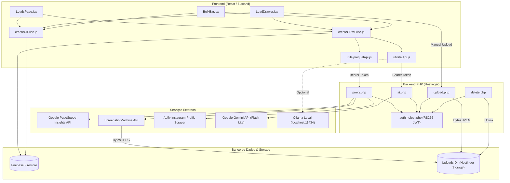

# AUDITORIA TÉCNICA E MAPA DE PREPARAÇÃO DA FASE R4: MÓDULO DE LEADS & CRM

**Data:** 05/11/2026  
**Projeto:** Dashboard Maieski  
**Fase Alvo:** R4 (R4.1: Listagem de Leads, Filtros, Tabela e Ações em Massa; R4.2: LeadDrawer, Formulários, Pré-Qualificação e IA)  
**Documento de Origem / Referência:** `docs/solvik-remake-plan.md`, `docs/solvik-reference-audit.md`, `docs/r1-implementation.md`, `docs/r2-implementation.md`, `docs/r3-implementation.md`  
**Escopo Desta Auditoria:** Análise técnica exaustiva do código-fonte existente do módulo de Leads, contratos de dados, dependências de store, fluxos de integração e fronteiras de apresentação para guiar a reconstrução visual subsequente sem provocar regressões funcionais.

---

## 1. INTRODUÇÃO E DIRETRIZES DE AUDITORIA

### 1.1 Contexto Geral do Projeto
O Dashboard Maieski está em processo de modernização visual baseado na referência estética Solvik (temas escuro/claro, superfícies de vidro, tipografia Urbanist, controles em pílula, docks e overlays refinados).
- **Fase R0:** Auditoria de referência visual e catálogo de capturas (35 PNGs).
- **Fase R1:** Fundação visual (Design System, tokens semânticos, Urbanist Variable, primitivos `components/ui/` como `Button`, `Card`, `Drawer`, `Modal`, `Table`, `Badge`, `Select`, `Input`).
- **Fase R2:** Shell desktop e mobile (`DesktopShell.jsx`, `DesktopShell.css`, `MobileShell.css`, navegação por abas superiores e action dock).
- **Fase R3.1:** Dashboard principal (`DashboardPage.jsx`, `DashboardPage.css`, KPIs, widgets e agenda).

A próxima etapa é a **Fase R4**, dividida operacionalmente em:
- **R4.1:** Página de listagem (`LeadsPage.jsx`), toolbar de filtros, status grid, resumo por lote, tabela de dados, paginação e barra de ações em massa (`BulkBar.jsx`).
- **R4.2:** Gaveta de edição e detalhe (`LeadDrawer.jsx`), formulários, diagnóstico comercial, pré-qualificação técnica (PageSpeed, Instagram, Screenshot), integração de IA (Gemini/Ollama) e Lightbox split-view.

### 1.2 Regra de Distinção de Evidências
Ao longo deste relatório, aplicam-se os seguintes rótulos de evidência:
- **[FATO CONFIRMADO]:** Verificado diretamente no código-fonte, nos arquivos de configuração ou nos testes executados.
- **[INFERÊNCIA TÉCNICA]:** Dedução lógica fundamentada no fluxo de arquitetura ou convenção do ecossistema, identificada explicitamente como recomendação.

---

## 2. AUDITORIA DA ARQUITETURA E MAPEAMENTO DE ARQUIVOS

### 2.1 Inventário de Arquivos do Módulo de Leads

| Arquivo Real | Linhas / Tamanho | Papel Arquitetural | Relação com a Fase R4 |
|---|---|---|---|
| `react-app/src/pages/LeadsPage.jsx` | 2.330 linhas (~124 KB) | Página principal do módulo de Leads. Contém barra de topo, cards de status, resumo por lote, toolbar de busca/filtros, tabela de leads, paginação, modais inline de progresso e listeners globais. | **Foco central da R4.1** |
| `react-app/src/pages/LeadsPage.css` | 75 linhas (~3.5 KB) | Estilos específicos para a listagem desktop de leads, sobrepondo tabelas e status cards com tokens R1. | **Arquivo de apoio da R4.1** |
| `react-app/src/components/modals/LeadDrawer.jsx` | 1.116 linhas (~51.6 KB) | Drawer lateral detalhado montado via `components/ui/Drawer.jsx`. Contém 3 seções: 1. Resumo, 2. Qualificação comercial e técnica, 3. Histórico de interações; integra IA, print/lightbox e navegação. | **Foco central da R4.2** |
| `react-app/src/components/modals/LeadForm.jsx` | 692 linhas (~40 KB) | Modal de lead tradicional em duas colunas. Usado como fallback quando `FEATURES.LEADS_DRAWER === false` ou via dispatcher genérico de modal. | **Componente legado preservado** |
| `react-app/src/components/BulkBar.jsx` | 117 linhas (~6 KB) | Barra flutuante de ações em massa disparada quando há seleção ativa de leads (`selectedItems.length > 0`). | **Foco da R4.1** |
| `react-app/src/components/ImportLeadsModal.jsx` | 437 linhas (~23.1 KB) | Wizard em 2 passos para importação de planilhas Excel (.xlsx/.xls) e arquivos CSV com mapeamento visual, charset UTF-8/Windows-1252 e criação em lote. | **Foco da R4.1** |
| `react-app/src/components/Modal.jsx` | 144 linhas (~7.3 KB) | Dispatcher global de overlays. Direciona `type === 'lead'` para `LeadDrawer` quando a flag `FEATURES.LEADS_DRAWER` estiver ativa. | **Contrato de integração R4.1/R4.2** |
| `react-app/src/components/modals/NovoFechamentoModal.jsx` | 785 linhas (~37.5 KB) | Wizard de conversão comercial de Lead em Cliente, Projeto, Recorrência e Lançamentos Financeiros. Disparado a partir do Lead. | **Contrato de integração comercial** |
| `react-app/src/components/modals/SupportForms.jsx` | 429 linhas (~19.4 KB) | Contém `CsvProgressModal` (modal legado de progresso CSV) e `CsvInfoModal` (instruções estáticas legadas). | **Contrato legado de apoio** |
| `react-app/src/store/slices/createCRMSlice.js` | 1.147 linhas (~47.3 KB) | Slice Zustand de CRM: mutações de leads (`saveLead`, `saveLeadNotes`), contatos (`logLeadContact`), pré-qualificação (`runPreQualification`), IA (`saveLeadAiQualification`), fechamento e filtros salvos. | **Core de Negócio (Inviolável)** |
| `react-app/src/store/slices/createUISlice.js` | 1.123 linhas (~54.1 KB) | Slice Zustand de UI: seleção em massa (`selectedItems`, `toggleSelect`, `selectAll`), abertura de modais (`openModal`, `closeModal`), exclusão e lixeira (`deleteItem`, `bulkDelete`). | **Core de UI (Inviolável)** |
| `react-app/src/config/features.js` | 25 linhas (~700 B) | Flags de funcionalidades ativas e inativas do sistema. | **Controle de visualização** |
| `react-app/src/utils/aiApi.js` | 281 linhas (~9.2 KB) | Cliente para o endpoint `ai.php` (Gemini Flash-Lite) e fallback Ollama local. | **Integração de IA** |
| `react-app/src/utils/prequalApi.js` | 193 linhas (~6.4 KB) | Cliente para o endpoint `proxy.php` (PageSpeed Insights, ScreenshotMachine e Apify Instagram). | **Integração Técnica** |
| `react-app/src/utils/prequalUtils.js` | 150 linhas (~4.1 KB) | Utilitários puros de parsing de links mistos (site/Instagram), extração de handles e formatação. | **Utilitário Puro** |
| `react-app/src/utils/crmAnalyticsUtils.js` | 610 linhas (~24 KB) | Cálculos analíticos puros sobre o array de leads (métricas de lote, ganchos de abordagem, fila do dia, enums). | **Utilitário Puro** |
| `react-app/public/proxy.php` | 439 linhas (~17.7 KB) | Proxy PHP autenticado (RS256) para PageSpeed, Instagram e ScreenshotMachine com rate-limiting. | **Backend Externo** |
| `react-app/public/ai.php` | 344 linhas (~14.7 KB) | Proxy PHP autenticado (RS256) para Gemini com cota diária local (60 chamadas). | **Backend Externo** |
| `react-app/public/upload.php` / `delete.php` | ~8 KB | Endpoints de upload de prints manuais e exclusão de mídia no storage. | **Backend Storage** |
| `react-app/public/auth-helper.php` | ~12 KB | Validação criptográfica RS256 de ID Tokens do Firebase. | **Segurança Backend** |

> [!IMPORTANT]
> **Caminho Real do LeadDrawer [FATO CONFIRMADO]:**  
> O arquivo do LeadDrawer **NÃO** reside na raiz de `src/components/`, mas sim em `src/components/modals/LeadDrawer.jsx`. O dispatcher `src/components/Modal.jsx` importa `LeadDrawer` deste caminho relativo `./modals/LeadDrawer`.

### 2.2 Estado das Feature Flags (`src/config/features.js`) [FATO CONFIRMADO]
```javascript
export const FEATURES = {
  // Módulos e visualizações secundárias
  LEADS_DRAWER: true,       // Ativo: utiliza LeadDrawer em vez de LeadForm
  LEADS_KANBAN: false,      // Inativo: visão Kanban oculta por padrão
  LEADS_FILA: false,        // Inativo: fila de prospecção oculta por padrão
  LEADS_ANALYTICS: false,   // Inativo: analytics CRM oculto por padrão
};
```
- Em `LeadsPage.jsx`, os seletores de visualização (Pill Tabs para Kanban, Fila e Analytics) são condicionados estritamente a estas flags. Como estão falsas, a página opera exclusivamente em `effectiveViewMode === 'list'`.
- **Diretriz R4:** Não ativar nem apagar os componentes `LeadsKanban.jsx`, `LeadsFollowUpQueue.jsx` ou `LeadsCRMAnalytics.jsx`. O redesign da R4 deve focar na visualização Lista (`list`) e no `LeadDrawer`.

---

## 3. MAPA FUNCIONAL DETALHADO DO MÓDULO DE LEADS

### 3.1 Os Seis Status de Leads [FATO CONFIRMADO]
A lista oficial de status é definida em `src/utils/crmAnalyticsUtils.js`:
```javascript
export const LEAD_STATUSES = [
  'Novo',
  'Abordado',
  'Follow-up',
  'Em negociação',
  'Fechado',
  'Perdido',
];
```

#### Ciclo de Vida e Regras Comerciais:
1. **Novo:** Lead recém-cadastrado ou importado via planilha. Nunca recebeu abordagem comercial (`dataAbordagem === null`). Cor: Azul (`var(--blue)` / `var(--blue-bg)`).
2. **Abordado:** Primeiro contato comercial realizado. Cor: Âmbar (`var(--amber)` / `rgba(59, 130, 246, 0.12)`).
3. **Follow-up:** Contato subsequente para manter a oportunidade ativa ou aguardando resposta. Cor: Ciano (`var(--cyan)` / `rgba(245, 158, 11, 0.12)`).
4. **Em negociação:** Proposta comercial enviada ou reunião agendada. Cor: Roxo (`var(--purple)` / `rgba(168, 85, 247, 0.12)`).
5. **Fechado:** Venda concluída. Habilita o botão direto "Converter em Cliente" (`convertLeadToCliente`), que dispara o wizard `NovoFechamentoModal`. Cor: Verde (`var(--green)` / `rgba(16, 185, 129, 0.12)`).
6. **Perdido:** Oportunidade perdida. **Regra de Negócio Crítica [FATO CONFIRMADO]:** Ao alterar o status de um lead para `Perdido`, tanto em `saveLead` quanto em `bulkEditLeads`, o sistema deleta automaticamente o screenshot do site armazenado no servidor Hostinger (`deleteFile(screenshotPath)`) para economizar storage.

#### Mecanismos de Transição de Status:
- **Avanço Rápido Cíclico:** Clique no corpo do badge de status na tabela invoca `handleNextStatus(lead, e)`, que calcula o próximo status via `(idx + 1) % LEAD_STATUSES.length`.
- **Menu Dropdown Direto:** Clique na seta do badge (`status-badge-arrow`) abre o menu flutuante `leads-status-menu` (`statusMenuLeadId === lead.id`), permitindo selecionar qualquer status diretamente.
- **Edição no Drawer:** Campo Select controlado em `LeadDrawer.jsx`.
- **Alteração em Massa:** Select na barra flutuante `BulkBar.jsx` invoca `bulkEditLeads('status', nextStatus)`.
- **Auditoria Histórica (`historicoStatus`):** Qualquer alteração de status adiciona um registro imutável no array `lead.historicoStatus` via helper `buildHistoricoEntry(statusAnterior, statusNovo)`.

### 3.2 Busca, Filtros e Resumo por Lote

#### 1. Busca Textual Ampla (`search`):
- Filtra em memória leads cujo `nome`, `nicho`, `cidade`, `lote` ou `site` contenha o termo digitado (case-insensitive).
- Botão "X" dentro do input limpa a busca e reseta para a página 1.

#### 2. Filtros Estruturados:
- **Status (`status`):** Filtra por um dos seis status ou todos.
- **Nicho (`nicho`):** Opções alimentadas dinamicamente por `configData.nichos`.
- **Cidade (`cidade`):** Opções extraídas em tempo de execução via `Set` sobre `data.leads`.
- **Lote (`loteFilter`):** Opções extraídas de `data.leads`. Suporta o valor sentinela especial `__SEM_LOTE__` para leads com campo `lote` vazio.
- **DDD (`ddd`):** Extrai os números do telefone (`l.telefone.replace(/\D/g, '')`) e aplica `startsWith(ddd)`.
- **Pré-Qualificação (`prequalFilter`):** Opções: `sim` (lead possui `prequalData`), `nao` (sem qualificação técnica).

#### 3. Filtros Rápidos de Produtividade (`quickFilter`):
- `abordadosHoje`: Leads com pelo menos uma interação `tipo === 'abordagem_inicial'` na data corrente (`new Date().toISOString().split('T')[0]`).
- `aguardandoRetorno`: Leads que não estão em `Fechado` nem `Perdido` e possuem interação `tipo === 'resposta_recebida'`.
- `botBarreira`: Leads marcados com flag booleana `botBarreira === true` (barreira de atendimento automatizado/robô no WhatsApp).

#### 4. Painel "Resumo por Lote" (`computeLoteSummary`):
- Painel colapsável acionado pelo botão "Resumo por Lote".
- Calcula em memória para cada lote: Total de Leads, Abordados (% taxa), Respostas (% taxa), Bot no WhatsApp (% taxa), Em Negociação e Fechados (% conversão).
- Clique em qualquer linha do resumo filtra automaticamente a tabela pelo lote correspondente.

### 3.3 Filtros Salvos Nomeados [FATO CONFIRMADO]
- **Persistência:** Gravados em `users/{uid}/settings/main` sob a chave `leadFilters: []`.
- **Funções da Store:** `saveLeadFilter(nome, filtros)` e `deleteLeadFilter(filterId)`.
- **UI:** Exibidos como pílulas logo acima da tabela. Se os filtros correntes corresponderem exatamente a um filtro salvo, a pílula exibe estilo ativo. Clique na pílula ativa aplica ou desmarca a combinação; botão "×" remove o filtro salvo do banco de dados.

### 3.4 Paginação de Registros
- **Opções Padrão:** 15, 30, 50, 100 itens por página (`PAGE_SIZE_OPTIONS = [15, 30, 50, 100]`). Padrão inicial: 30 itens.
- **Tamanho Personalizado:** Input numérico integrado permitindo de 1 a 1000 itens por página.
- **Algoritmo de Elipses (`getPaginationItems`):**
  - Se `totalPages <= 7`: exibe todas as páginas.
  - Se `safePage <= 4`: exibe `[1, 2, 3, 4, 5, '...', totalPages]`.
  - Se `safePage >= totalPages - 3`: exibe `[1, '...', totalPages - 4, ..., totalPages]`.
  - Caso intermediário: exibe `[1, '...', safePage - 1, safePage, safePage + 1, '...', totalPages]`.
- **Controles de Navegação:** Primeira página (`safePage === 1`), Anterior, Próxima e Última página (`safePage === totalPages`).

### 3.5 Ordenação
- **Dropdown Global (`sort`):**
  - `criadoDesc`: Mais recentes (data de criação decrescente).
  - `criadoAsc`: Mais antigos (data de criação crescente).
  - `nomeAz`: Nome A-Z (`localeCompare('pt-BR')`).
  - `nomeZa`: Nome Z-A.
  - `modificadoDesc`: Última modificação decrescente.
- **Ordenação por Cabeçalho de Coluna (`columnSort`):**
  - Suporta clique nas colunas: Nome/Empresa, Telefone, Nicho, Site/Social, Status, Qualificação.
  - Alterna entre `asc` (↑) e `desc` (↓), com indicador visual `↕`.

### 3.6 Importação CSV e Planilhas (`ImportLeadsModal.jsx`)
- **Gatilho:** Botão "Importar CSV" no cabeçalho chama `openModal('csvInfo')`.
- **Processamento:** Suporta arquivos `.xlsx`, `.xls` e `.csv`. Para CSV, executa decodificação com fallback inteligente entre `UTF-8` e `Windows-1252` para evitar caracteres corrompidos (*mojibake*).
- **Passo 1 (Upload):** Leitura de buffer via `FileReader` e parsing com biblioteca `xlsx`.
- **Passo 2 (Mapeamento Visual):**
  - Seleção da aba/planilha (`SheetNames`).
  - Seleção da linha de cabeçalho (detecta automaticamente a primeira linha com 2+ células preenchidas).
  - Mapeamento de 7 colunas: `nome` (obrigatório), `telefone`, `site`, `observacoes`, `nicho`, `status`, `cidade`.
  - Valores padrão/fallback para nicho, status e cidade fixa.
  - Sugestão automática de Lote: `${cidadeMaisComum} ${MM/AAAA}`.
  - Tabela de pré-visualização dos 10 primeiros registros tratados.
- **Gravação em Lote:** Executa `bulkAddLeads(validRows)` no slice CRM, dividindo em *chunks* de até 450 documentos por `writeBatch(db)` no Firestore.

### 3.7 Exportação CSV [FATO CONFIRMADO vs INFERÊNCIA]
> [!WARNING]
> **FATO CONFIRMADO NO CÓDIGO:**  
> **NÃO existe atualmente nenhum botão de "Exportar CSV" de leads na interface de `LeadsPage.jsx`**, nem existe uma função `exportLeadsCSV` em `createCRMSlice.js` ou `createUISlice.js`.
> 
> O sistema possui apenas:
> 1. `exportFinancasCSV(colName, list, filename)` em `createUISlice.js` (exclusivo para Finanças PJ/PF).
> 2. `exportData()` em `createUISlice.js` (exportação global de backup em JSON na tela de Configurações).
> 
> **Recomendação para a Fase R4.1 [INFERÊNCIA TÉCNICA]:**  
> Caso o redesign Solvik preveja exportação na toolbar de Leads (como no template original), deve-se implementar uma função `exportLeadsCSV(filteredLeads)` no store ou componente, utilizando o mesmo padrão com BOM `\uFEFF` e delimitador `;` já consagrado em `exportFinancasCSV`.

### 3.8 Seleção e Ações em Massa (`BulkBar.jsx`)
- **Seleção Individual:** Checkbox de cada linha invoca `toggleSelect('leads', l.id)`.
- **Seleção da Página:** Checkbox mestre no cabeçalho invoca `selectAll('leads', pageIds)`.
- **Estado Global:** `selectedItems: []` e `currentBulkCol: 'leads'` em `createUISlice.js`.
- **Barra Flutuante (`BulkBar.jsx`):**
  - Exibe contador: `N selecionado(s)`.
  - **Excluir Todos:** Chama `bulkDelete()`, que solicita confirmação e adiciona `deletadoEm: ISOString` a todos os selecionados (soft-delete).
  - **Pré-Qualificar (N):** Executa `handlePreQualification({ withAi })` apenas sobre leads que possuem site ou Instagram válido.
  - **Toggle IA:** Alterna `withAi` entre ativo (inclui qualificação e priorização por IA) e inativo.
  - **Alterar Status em Massa:** Select que executa `bulkEditLeads('status', valor)`. Se alterado para `Perdido`, aciona a exclusão dos screenshots associados.
  - **Alterar Nicho em Massa:** Select que executa `bulkEditLeads('nicho', valor)`.
  - **Cancelar:** Invoca `clearBulk()`, esvaziando a seleção.

### 3.9 Registro de Interações Comerciais e Gatilho WhatsApp
- **Detecção de Clique no WhatsApp:**
  - Clique em links `getWaLink(telefone)` dispara evento personalizado `msk:wa-clicked` e armazena estado `pendingWaLead = { id, nome, status, clickedAt }`.
  - Listener de `visibilitychange` e `window.onfocus`: quando o usuário retorna à aba do Dashboard em até 10 minutos após clicar no WhatsApp, surge uma barra de confirmação: *"Enviou para [Nome]?"*.
  - Ao confirmar ("Sim, registrar"): invoca `logLeadContact(leadId, { tipo, texto, novoStatus })`. Se o lead era `Novo`, transiciona automaticamente para `Abordado`.
- **Registro Rápido na Tabela:**
  - Botão de check: invoca `addLeadInteracao(lead.id, { tipo: 'resposta_recebida', texto: 'Resposta recebida' })`.
  - Botão de bot: alterna flag `toggleLeadBotBarreira(lead.id)`.

---

## 4. ANÁLISE PROFUNDA DO LEADDRAWER (`LeadDrawer.jsx`)

### 4.1 Contrato de Entrada (Props)
```javascript
export default function LeadDrawer({ isOpen, onClose, item })
```
- `isOpen` *(boolean)*: Controla se o drawer está visível.
- `onClose` *(function)*: Callback disparado ao fechar (Esc, backdrop, botão de cancelar ou após salvar).
- `item` *(object | null)*: Objeto do lead selecionado para edição, ou `null`/`undefined` para cadastro de novo lead.

### 4.2 Estados Locais e Ciclo de Vida
Quando `item?.id` ou `isOpen` mudam, um `useEffect` sincroniza o estado `f` do formulário:
```javascript
const [f, setF] = useState({
  nome: item?.nome || '',
  telefone: item?.telefone || '',
  cidade: item?.cidade || '',
  lote: item?.lote || '',
  email: item?.email || '',
  origem: item?.origem || '',
  valorEstimado: item?.valorEstimado || '',
  ultimoContato: item?.ultimoContato || '',
  proximoContato: item?.proximoContato || '',
  nicho: item?.nicho || configData.nichos[0] || '',
  status: item?.status || 'Novo',
  site: item?.site || '',
  observacoes: item?.observacoes || '',
  interacoes: item?.interacoes || [],
  botBarreira: !!item?.botBarreira,
  qualChips: Array.isArray(item?.qualChips) ? item.qualChips : [],
});
```

Estados auxiliares do drawer:
- `intText`, `intTipo`: Criação de nova interação na Seção 3.
- `isPrequaling`: Indicador de análise técnica em andamento.
- `isAiQualifying`: Indicador de qualificação IA em andamento.
- `aiDraft`: Rascunho `{ chips, resumo, prioridade }` sugerido pela IA aguardando confirmação humana.
- `aiError`: Mensagem de erro de API de IA.
- `msgTipo`: Tipo da mensagem a gerar (`'abordagem_inicial'` ou `'follow_up'`).
- `isGeneratingMsg`: Indicador de geração de mensagem em andamento.
- `msgDraft`: Texto da mensagem de abordagem gerada para cópia ou abertura no WhatsApp.
- `msgError`: Erro na geração de mensagem.
- `lightboxOpen`, `lightboxNotes`: Controle do visualizador de imagem split-screen.
- `singleProgress`: Progresso em tempo real das etapas da pré-qualificação individual.
- `isSaving`: Bloqueio contra múltiplos envios durante salvamento.
- `isUploadingPrint`: Indicador de upload de screenshot colado via Ctrl+V.

### 4.3 Seletores e Ações Zustand Utilizados

```javascript
// Seletores de leitura:
const data = useDash(s => s.data);
const configData = useDash(s => s.configData);
const aiUsage = useDash(s => s.aiUsage);
const filteredLeadIds = useDash(s => s.filteredLeadIds);

// Ações de mutação e navegação:
const saveLead = useDash(s => s.saveLead);
const saveLeadNotes = useDash(s => s.saveLeadNotes);
const openModal = useDash(s => s.openModal);
const goTo = useDash(s => s.goTo);
const setConfigTab = useDash(s => s.setConfigTab);
const runPreQualification = useDash(s => s.runPreQualification);
const deleteLeadScreenshot = useDash(s => s.deleteLeadScreenshot);
const uploadManualScreenshot = useDash(s => s.uploadManualScreenshot);
const saveLeadAiQualification = useDash(s => s.saveLeadAiQualification);
const setAiUsage = useDash(s => s.setAiUsage);
const refreshAiUsage = useDash(s => s.refreshAiUsage);
```

### 4.4 As Três Seções Estruturais do LeadDrawer

#### Seção 1: Resumo Cadastral
- **Campos:** Nome / Empresa (obrigatório com validação), Telefone/WhatsApp (com link direto de abertura), Status, Nicho (com atalho para gerenciar nichos em Configurações), Cidade (com `<datalist>` de cidades existentes), Lote (com `<datalist>`), Site / Instagram (com link direto), E-mail, Valor Estimado (R$), Origem do Lead, Último Contato e Próximo Contato.

#### Seção 2: Qualificação Comercial, Técnica e IA
- **Contador de Cota:** Exibe `IA hoje: {used}/{limit}` alimentado por `aiUsage`.
- **Botão "Qualificar Agora" / "Re-qualificar Site":** Dispara `runPreQualification([item.id])` (PageSpeed + Instagram + Screenshot).
- **Botão "Qualificar com IA":** Dispara `qualifyLeadWithAi(mergedLead)`. Apresenta o card de rascunho `aiDraft` com chips sugeridos, resumo e prioridade (`alta`, `media`, `baixa`). Requer clique em "Confirmar e Salvar" para persistir no lead via `saveLeadAiQualification`.
- **Chips de Diagnóstico Rápido (`QUAL_CHIPS`):**
  - `sem_ssl`: Sem SSL
  - `lento_mobile`: Lento no mobile
  - `visual_antigo`: Visual antigo
  - `sem_whatsapp`: Sem WhatsApp
  - `sem_site`: Sem site
  - Pílula especial `botBarreira`: 🤖 Bot no WhatsApp.
- **Card de Notas PageSpeed:** Exibe scores de 0 a 100 para Mobile e Desktop via componente `PageSpeedScore`.
- **Card de Dados Instagram:** Exibe contagem de seguidores, bio e link na bio retornados pelo Apify.
- **Área de Screenshot:** Exibe imagem capturada com cache-buster (`?t=timestamp`). Se ausente, exibe área para colar print com `Ctrl+V`.
- **Geração de Mensagem Comercial:** Permite escolher entre "Abordagem inicial" ou "Follow-up", e gerar via:
  - ✨ *Gerar mensagem com IA* (`generateLeadMessageWithAi`).
  - ⚡ *Modelo rápido (offline)* (`generatePitchMessage` - gratuito e imediato).
  - Textarea de edição final com botões "Copiar" e "Abrir WhatsApp com o texto ↗".

#### Seção 3: Histórico de Interações
- Lista cronológica de interações passadas exibindo data formatada (`DD/MM/AAAA`), tag do tipo (`INTERACAO_TIPO_LABELS`) e texto.
- Botão rápido "✓ Marcar resposta": cria interação imediata de `resposta_recebida` e atualiza `ultimoContato`.
- Seletor de tipos: Abordagem Inicial, Follow-up, Resposta Recebida, Reunião, Proposta, Outro.
- Input de texto que adiciona nova interação ao pressionar Enter ou clicar em "Adicionar".
- Botão "×" na linha para remover interação específica do array local.

### 4.5 Recursos Avançados do LeadDrawer

#### 1. Atalho Ctrl+V para Upload de Print:
- Um listener de `paste` intercepta arquivos de imagem colados da área de transferência.
- Função `resizeImageToMax1600(file)`: cria elemento `<canvas>`, redimensiona a imagem proporcionalmente para dimensão máxima de 1600px em JPEG (qualidade 0.85) e executa `uploadManualScreenshot(item.id, resizedFile)`.

#### 2. Lightbox Split-Screen (80% Visualizador / 20% Anotações):
- Ao clicar na imagem do print, abre o overlay `lightbox-overlay` em tela cheia com backdrop blur (12px).
- Lado esquerdo (80%): Visualizador de alta resolução com rolagem vertical suave.
- Lado direito (20%): Painel escuro com textarea para anotações em tempo real. Ao clicar em "Salvar", persiste no Firestore via `saveLeadNotes(item.id, lightboxNotes)` sem precisar fechar o lead.

#### 3. Navegação por Teclado e Fila Filtrada:
- Teclas `ArrowUp` (↑) e `ArrowDown` (↓) navegam diretamente para o lead anterior ou próximo.
- **Regra de Foco:** O atalho é ignorado se o foco estiver dentro de elementos editáveis (`input`, `textarea`, `select`) ou se o Lightbox estiver aberto.
- **Fila Filtrada (`navListIds`):** Utiliza a lista de IDs resultante dos filtros atuais da tabela (`filteredLeadIds`). Se a tabela estiver filtrada por "Curitiba", navegar no drawer percorrerá apenas os leads de Curitiba.

#### 4. Atalho Ctrl+S:
- Dispara `handleSave()` instantaneamente sem recarregar a página, apresentando feedback de loading e toast de confirmação.

#### 5. Conversão Comercial em Cliente:
- Botão "Converter em Cliente" no rodapé invoca `convertLeadToCliente(item.id)`, abrindo o wizard `NovoFechamentoModal` com os dados do lead pré-preenchidos.

---

## 5. MAPA DAS INTEGRAÇÕES EXTERNAS E FLUXOS DE GRAVAÇÃO

### 5.1 Diagrama de Integrações



### 5.2 Detalhamento de Cada Integração

| Integração | Rota / Arquivo Front | Endpoint Backend | Provedor Externo | Mecanismo de Segurança / Cota | Gatilho de Disparo |
|---|---|---|---|---|---|
| **PageSpeed** | `prequalApi.js -> fetchPageSpeed` | `GET proxy.php?action=pagespeed` | Google PageSpeed Insights | Token Firebase RS256; Rate-limit: 300 req/dia | Ação explícita no Drawer ou Ação em Massa |
| **Screenshot** | `prequalApi.js -> fetchScreenshot` | `POST proxy.php?action=screenshot` | ScreenshotMachine | Token Firebase RS256; Rate-limit: 150 req/dia; valida bytes mágicos FFD8FF | Ação explícita no Drawer ou Ação em Massa |
| **Instagram** | `prequalApi.js -> fetchInstagramData` | `POST proxy.php?action=instagram` | Apify (Instagram Scraper) | Token Firebase RS256; Rate-limit: 150 req/dia | Ação explícita no Drawer ou Ação em Massa |
| **Qualificação IA** | `aiApi.js -> qualifyLeadWithAi` | `POST ai.php?action=qualify` | Gemini 2.5 Flash-Lite (ou Ollama local) | Token Firebase RS256; Cota diária estrita de 60 chamadas em `ai-usage.json` | Botão "Qualificar com IA" ou Ação em Massa com IA ativa |
| **Mensagem IA** | `aiApi.js -> generateLeadMessageWithAi` | `POST ai.php?action=message` | Gemini 2.5 Flash-Lite (ou Ollama local) | Token Firebase RS256; consome cota diária do `ai-usage.json` | Botão "Gerar mensagem com IA" no Drawer |
| **Upload de Print** | `createCRMSlice.js -> uploadManualScreenshot` | `POST upload.php` | Storage próprio PHP | Token Firebase RS256; compressão prévia via Canvas max 1600px | Colar imagem com Ctrl+V no Drawer |
| **Exclusão de Print**| `createCRMSlice.js -> deleteLeadScreenshot` | `POST delete.php` | Storage próprio PHP | Token Firebase RS256; sanitização contra path traversal | Botão "Remover print", mudar status para "Perdido" ou esvaziar lixeira |
| **Banco Firestore** | `createCRMSlice.js` / `createUISlice.js` | SDK Firebase direto | Firestore (`users/{uid}/leads`) | Regras de segurança Firestore baseadas em `request.auth.uid` | Salvamentos, edições em massa, exclusões e importações |

> [!CAUTION]
> **Proibição Absoluta de Chamadas Automáticas:**  
> Nenhuma integração externa (PageSpeed, Screenshot, Apify ou Gemini) pode ser invocada na montagem de componentes, em `useEffect`, em renderizações de tabela ou durante animações visuais. Todas as requisições devem decorrer estritamente de interações intencionais do usuário.

---

## 6. SEPARAÇÃO ENTRE APRESENTAÇÃO (UI) E LÓGICA DE NEGÓCIO

### 6.1 Classificação Arquitetural dos Componentes

| Componente / Módulo | Apresentação Visual (UI) | Estado Local (State) | Lógica Comercial (Business) | Persistência / Integrações | Classificação de Risco no Redesign |
|---|---|---|---|---|---|
| `LeadsPage.jsx` | Tabela, cards de status, paginação, toolbar de chips. | Busca, filtros, página, tamanho, modal de filtro mobile, dropdown de status, prompt WhatsApp, undo toast. | Cálculo de totais por status, filtro composto em memória, ordenação composta, detecção de retorno do WhatsApp. | `deleteItem`, `bulkDelete`, `toggleSelect`, `openModal`, `saveLead`. | **Alto Risco:** contém mais de 2.000 linhas misturando lógica analítica e manipulação de DOM. |
| `LeadDrawer.jsx` | Layout do drawer, tabs de seções, badges de score, visualizador de print, lightbox. | Form `f`, inputs de interação, rascunho de IA, rascunho de mensagem, loading states, notas do lightbox. | Validação de campos obrigatórios, mesclagem de dados para IA, redimensionamento de imagem em canvas. | `saveLead`, `saveLeadNotes`, `saveLeadAiQualification`, `uploadManualScreenshot`, `runPreQualification`. | **Alto Risco:** concentra integração com backend PHP, IA e ciclo de vida de imagens. |
| `BulkBar.jsx` | Barra flutuante pill, botões de ação e selects de alteração em massa. | Toggle local `withAi` (ativo/inativo). | Verificação de leads aptos para qualificação (`leadHasValidSiteOrInstagram`). | `bulkDelete`, `bulkEditLeads`, `handlePreQualification`, `clearBulk`. | **Baixo Risco:** isolado e desacoplado, facilmente restilizável. |
| `ImportLeadsModal.jsx`| Formulário wizard em 2 passos, tabela de pré-visualização. | Arquivo, workbook, aba selecionada, mapeamento de colunas, lote sugerido. | Leitura de Excel/CSV, detecção de delimitador e charset, higienização *mojibake*. | `bulkAddLeads` (gravação em lote no Firestore). | **Médio Risco:** manter o motor de processamento do arquivo e restilizar apenas os formulários. |
| `NovoFechamentoModal.jsx`| Wizard em 5 etapas para conversão de lead em cliente. | Estados de formulário de cada entidade (cliente, projeto, recorrência, receita). | Cálculo de parcelamento, deduções, validação de CPF/CNPJ e busca na BrasilAPI. | Gravação transacional em batch no Firestore (`salvarNovoFechamento`). | **Crítico (pertence à Fase R5):** não alterar na R4. |

### 6.2 Regras de Negócio e Cálculos Misturados no JSX (A Preservar Intactos)

1. **Janela de 10 minutos do WhatsApp (`LeadsPage.jsx` linhas 343–362):**
   ```javascript
   const elapsed = Date.now() - pendingWaLead.clickedAt;
   if (elapsed <= 10 * 60 * 1000) {
     setWaPromptLead(pendingWaLead);
   }
   ```
   *Não alterar:* Essa janela garante que a confirmação de envio só apareça se o retorno do WhatsApp ocorrer em tempo hábil.

2. **Filtro Composto com Ordenação Dupla (`LeadsPage.jsx` linhas 494–544):**
   A filtragem combina 9 critérios em memória seguidos por `sortData(filtered, sort)` e depois pela ordenação por cabeçalho (`columnSort.key`). Essa ordem de precedência deve ser mantida idêntica.

3. **Geração do Link de WhatsApp com Texto Codificado (`LeadDrawer.jsx` linhas 300–315):**
   Gera `${waBase}?text=${encodeURIComponent(msgDraft.trim())}` e emite evento `msk:wa-clicked` na janela para iniciar o monitoramento de retorno.

4. **Compressão de Print no Paste (`LeadDrawer.jsx` linhas 13–43):**
   A função `resizeImageToMax1600` calcula a escala com base em `maxDim = 1600` e converte para JPEG `0.85`. Essa lógica deve ser mantida pura sem misturar com estilos.

---

## 7. PLANO DE IMPLEMENTAÇÃO: FASES R4.1 E R4.2

### 7.1 Fase R4.1: Listagem de Leads, Toolbar, Tabela e Ações em Massa

#### Objetivo:
Reconstruir a página de listagem (`LeadsPage.jsx`) com a identidade Solvik desktop (grid translúcido de status, barra de filtros pill, tabela com tipografia Urbanist, seleção com destaque e `BulkBar` flutuante moderna), mantendo a navegação e o suporte responsivo.

#### Arquivos Envolvidos:
- `src/pages/LeadsPage.jsx` (reestruturação do JSX e apresentação).
- `src/pages/LeadsPage.css` (estilos dedicados à página de listagem).
- `src/components/BulkBar.jsx` (restilização da barra de ações em massa).
- `src/components/ImportLeadsModal.jsx` (restilização dos controles do wizard de importação).

#### Componentes Reutilizáveis (Design System R1 / Shell R2):
- `components/ui/Button.jsx`: Botões primários, secundários, ícones e estados de loading.
- `components/ui/Badge.jsx`: Badges de status dos leads (`Novo`, `Abordado`, etc.).
- `components/ui/Table.jsx`: Primitivos de tabela responsiva.
- `components/ui/Card.jsx`: Cartões translúcidos para o resumo de lotes.
- `components/ui/Input.jsx`: Campo de busca e inputs numéricos.
- `components/CustomSelect.jsx`: Selects em estilo pílula (`variant="chip"`).
- `components/shared.jsx`: `CopyCell` (cópia rápida de telefone).

#### Riscos de Regressão e Proteções da R4.1:
1. *Risco:* Perda da sincronização de IDs filtrados (`setFilteredLeadIds`), quebrando a navegação por setas do LeadDrawer.  
   *Proteção:* Preservar o `useEffect` que executa `setFilteredLeadIds(list.map(l => l.id))`.
2. *Risco:* Quebra da ordenação combinada (menu global vs cabeçalho da tabela).  
   *Proteção:* Manter o bloco de `useMemo` de cálculo de dados idêntico.
3. *Risco:* Sobrescrita acidental do status ao clicar no badge.  
   *Proteção:* Preservar a distinção entre clique no badge (avanço) e clique na seta (abertura do menu).

### 7.2 Fase R4.2: LeadDrawer, Formulários, Pré-Qualificação e IA

#### Objetivo:
Modernizar a gaveta lateral de detalhes do lead (`LeadDrawer.jsx`), alinhando o layout ao visual Solvik (superfície translúcida, raios de 28px, tipografia Urbanist, tabs elegantes para as 3 seções, painéis colapsáveis de IA e Lightbox split-view com alto contraste).

#### Arquivos Envolvidos:
- `src/components/modals/LeadDrawer.jsx` (reorganização visual e de formulários).
- `src/components/ui/Drawer.jsx` (primitivo R1 já existente).
- `src/components/modals/LeadForm.jsx` (manter intacto como fallback).

#### Componentes Reutilizáveis:
- `components/ui/Drawer.jsx`: Camada portal nativa com animação Framer Motion e retenção de foco.
- `components/ui/Badge.jsx`: Badges de status e chips de qualificação rápida.
- `components/ui/Button.jsx`: Ações de salvamento, descarte e chamadas de API.
- `components/CustomSelect.jsx`: Selects de status, nicho e origem.

#### Riscos de Regressão e Proteções da R4.2:
1. *Risco:* Disparar chamadas acidentais de API de IA ao abrir o drawer, consumindo a cota de 60 chamadas/dia.  
   *Proteção:* Garantir que `qualifyLeadWithAi` e `generateLeadMessageWithAi` sejam disparadas **somente** por eventos explícitos `onClick` do usuário.
2. *Risco:* Quebra do upload de print via `Ctrl+V` ou envio de imagem não redimensionada gerando estouro de memória no backend.  
   *Proteção:* Manter a rotina `resizeImageToMax1600` via Canvas antes de qualquer chamada a `uploadManualScreenshot`.
3. *Risco:* Perda das anotações feitas no Lightbox.  
   *Proteção:* Preservar a ação `saveLeadNotes(item.id, lightboxNotes)` vinculada ao botão "Salvar" do Lightbox.
4. *Risco:* Desconexão da conversão em cliente.  
   *Proteção:* Preservar a chamada `useDash.getState().convertLeadToCliente(item.id)`.

---

## 8. CASOS DE TESTE E CRITÉRIOS DE VALIDAÇÃO

Para que a implementação das fases R4.1 e R4.2 seja considerada aprovada, outro agente ou desenvolvedor deverá verificar com sucesso os seguintes casos de teste:

### R4.1 — Listagem e Operações em Massa:
1. **Filtros e Busca:**
   - Digitar termo no input de busca e verificar se a lista filtra instantaneamente por nome, telefone, nicho, cidade ou lote.
   - Selecionar um Status, Nicho e Cidade e verificar se a contagem total de itens e as páginas refletem a filtragem.
   - Ativar o filtro rápido "Abordados hoje" e verificar se exibe apenas os leads com abordagem na data.
   - Clicar em "Limpar" e verificar se todos os filtros retornam ao estado padrão e a página volta para 1.
2. **Paginação:**
   - Alternar entre 15, 30, 50 e 100 itens por página; validar mudança no número de linhas renderizadas e recálculo das páginas.
   - Digitar valor customizado (ex: 20) no campo de itens por página e verificar aplicação correta.
   - Navegar para próxima, anterior, última e primeira página.
3. **Ordenação:**
   - Clicar no cabeçalho "Nome / Empresa" e verificar ordenação alfabética A-Z; clicar novamente para Z-A.
   - Alternar no menu global para "Mais recentes" e verificar ordem decrescente de criação.
4. **Status e Undo:**
   - Clicar no badge de status para avançar de "Novo" para "Abordado"; verificar se o toast de Undo aparece e se ao clicar em "Desfazer" o status anterior é restaurado.
5. **Ações em Massa (BulkBar):**
   - Selecionar 3 leads via checkbox; validar aparecimento da `BulkBar` flutuante com texto "3 selecionado(s)".
   - Alterar status em massa para "Em negociação" e validar confirmação e atualização das 3 linhas.
   - Clicar em "Cancelar" e validar que a barra desaparece e os checkboxes são desmarcados.
6. **Importação CSV / Planilha:**
   - Abrir o modal de importação e carregar arquivo CSV ou XLSX de teste.
   - Mapear colunas e confirmar importação; verificar se os leads aparecem na tabela com acentuação correta (*sem mojibake*).

### R4.2 — LeadDrawer e Integrações:
1. **Abertura e Fechamento:**
   - Clicar no nome de um lead na tabela e validar abertura do `LeadDrawer` com os dados populados.
   - Pressionar tecla `Esc` e validar fechamento restaurando foco para o elemento de origem.
2. **Navegação por Fila:**
   - Pressionar setas `ArrowDown` e `ArrowUp` fora de campos de texto e validar navegação entre leads da lista filtrada.
3. **Edição e Salvamento:**
   - Modificar o campo "Telefone" e pressionar `Ctrl+S`; verificar toast de confirmação e persistência do dado sem fechar o drawer.
4. **Interações:**
   - Digitar texto no histórico, selecionar tipo "Reunião" e pressionar Enter; validar inserção da linha no histórico.
   - Clicar no botão "✓ Marcar resposta" e verificar inclusão imediata com data de hoje.
5. **Pré-Qualificação e IA (Ações Explícitas):**
   - Clicar em "Qualificar Agora" em ambiente de teste e validar log de progresso das etapas.
   - Clicar em "Gerar mensagem com IA" e validar se o rascunho aparece na textarea; testar também o "Modelo rápido (offline)".
6. **Print e Lightbox:**
   - Colar imagem com `Ctrl+V` e verificar upload e renderização do thumbnail.
   - Clicar no print para abrir o Lightbox; digitar anotação no painel lateral direito, clicar em "Salvar" e fechar o Lightbox.
7. **Conversão em Cliente:**
   - Clicar em "Converter em Cliente" e verificar abertura do modal de fechamento comercial com os dados pré-carregados.

---

## 9. SÍNTESE E RESUMO DE RISCOS

### Principais Descobertas:
1. **Caminho Real do Drawer:** O arquivo está localizado em `src/components/modals/LeadDrawer.jsx` (e não em `src/components/LeadDrawer.jsx`).
2. **Ausência de Exportação CSV:** Não existe exportação de leads para CSV implementada no código atual. Qualquer inclusão deve ser tratada como nova funcionalidade ou mantida fora do escopo se o objetivo for paridade estrita.
3. **Acoplamento de Lógica no JSX:** Mais de 2.300 linhas em `LeadsPage.jsx` contêm lógica de negócio misturada (cálculos de conversão de lote, detecção de retorno do WhatsApp em 10 minutos, gerador de texto para clipboard).
4. **Gestão Rigorosa de Cotas:** A IA possui teto diário de 60 chamadas por usuário gravado no servidor Hostinger (`uploads/{uid}/ai-usage.json`), e as APIs do Google/Screenshot/Apify possuem rate limits diários em `proxy.php`.
5. **Primitivo de Drawer R1 Consolidado:** O primitivo `components/ui/Drawer.jsx` da R1 já suporta portal, animações Framer Motion, backdrop blur e retenção de foco, fornecendo a base ideal para o redesign da R4.2.

### Principais Riscos Identificados:
- **Risco de Consumo Acidental de Cota:** Renderizar componentes que disparem IA automaticamente esgotará a cota do usuário em segundos.
- **Risco de Perda de Dados em Cascata:** Mudar lead para "Perdido" apaga o screenshot permanentemente do storage PHP. O redesign de UI deve garantir que essa mudança de status não seja acionada por engano.
- **Risco de Regressão de Acentuação:** A importação de CSV depende da decodificação com suporte a Windows-1252 e da limpeza de mojibake; qualquer simplificação ingênua quebrará caracteres especiais em português.
- **Risco de Quebra da Navegação Sequencial:** O LeadDrawer depende estritamente do array `filteredLeadIds` gerado por `LeadsPage.jsx`. Se a página de listagem parar de atualizar esse array, as setas ↑/↓ do drawer pararão de funcionar.

---
*Fim do Relatório Técnico da Fase R4.*

