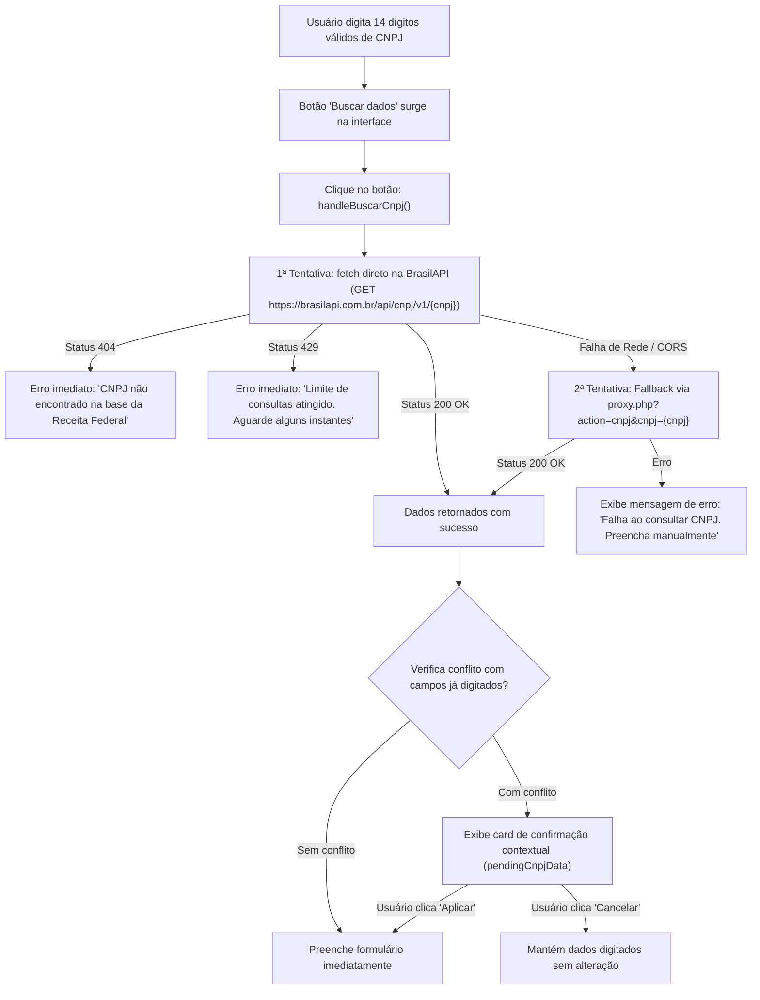
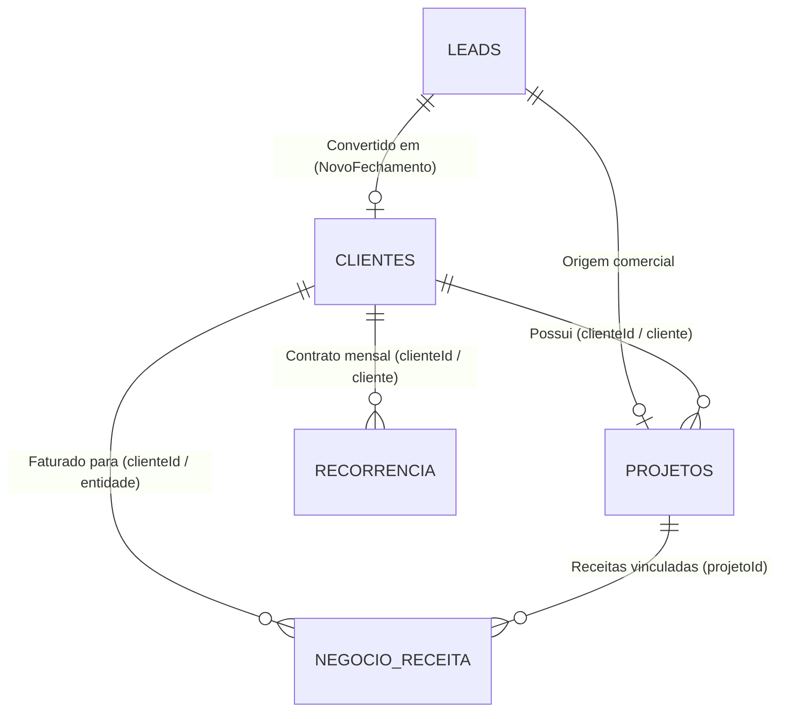

# AUDITORIA TÉCNICA E MAPA DE PREPARAÇÃO DA FASE R5: MÓDULOS CLIENTES E PROJETOS

**Data:** 06/11/2026  
**Projeto:** Dashboard Maieski  
**Fase Alvo:** R5 (R5.1: Módulo Clientes — Listagem, Perfil, Formulários; R5.2: Módulo Projetos — Listagem, Detalhes, Formulários, Duplicação)  
**Documentos de Referência:** `docs/solvik-remake-plan.md`, `docs/solvik-reference-audit.md`, `docs/r1-implementation.md`, `docs/r2-implementation.md`, `docs/r3-implementation.md`, `docs/r4-technical-audit.md`, `docs/r4-implementation.md`, `docs/r4.2-implementation.md`  
**Escopo Desta Auditoria:** Investigação técnica profunda do código-fonte existente dos módulos de Clientes e Projetos, contratos de dados, dependências da store Zustand, relações intermodulares com Finanças/Leads, fluxos de integração externa (BrasilAPI / proxy) e baseline visual completo com 18 screenshots reais (1440x900) para preparar a reconstrução visual subsequente sem provocar regressões funcionais.

---

## 1. INTRODUÇÃO E DIRETRIZES DE AUDITORIA

### 1.1 Contexto Geral do Projeto
O Dashboard Maieski está em processo de modernização visual baseado na referência estética Solvik (temas escuro e claro, superfícies de vidro, tipografia Urbanist, controles em pílula, docks e overlays refinados).
- **Fases Concluídas e Validadas:**
  - **Fase R0:** Auditoria de referência visual e catálogo de capturas da Solvik.
  - **Fase R1:** Fundação visual (Design System, tokens semânticos, Urbanist Variable, primitivos `components/ui/`: `Button`, `Card`, `Drawer`, `Modal`, `Table`, `Badge`, `Select`, `Input`, `CopyButton`).
  - **Fase R2:** Shell desktop e mobile (`DesktopShell.jsx`, `DesktopShell.css`, `MobileShell.css`, abas superiores e action dock).
  - **Fase R3.1:** Dashboard principal (`DashboardPage.jsx`, composição 12 colunas, KPIs, widgets e agenda).
  - **Fase R4.1:** Listagem de Leads (`LeadsPage.jsx`, filtros pill, tabela Urbanist e `BulkBar.jsx`).
  - **Fase R4.2:** Gaveta de edição e detalhe do lead (`LeadDrawer.jsx`, abas em cartões translúcidos, integração técnica e IA).

A próxima etapa é a **Fase R5**, dividida operacionalmente em:
- **R5.1:** Módulo Clientes (Listagem de clientes, diretório com abas Ativos/Inativos/Todos, perfil do cliente com histórico completo, formulário de cadastro/edição, máscaras e consulta de CNPJ com fallback).
- **R5.2:** Módulo Projetos (Listagem de projetos com tabela de histórico e cards mobile, visualizador de detalhes `ProjectView.jsx`, formulário de criação/edição `ProjetoForm.jsx`, ações em massa e duplicação segura).

### 1.2 Regra de Distinção de Evidências
Ao longo deste relatório, aplicam-se rigorosamente os seguintes rótulos de evidência:
- **[FATO CONFIRMADO]:** Verificado diretamente no código-fonte, nos arquivos de configuração ou nos testes executados via DevTools MCP.
- **[INFERÊNCIA TÉCNICA]:** Dedução lógica fundamentada no fluxo de arquitetura ou convenção do ecossistema, identificada explicitamente como recomendação.
- **[PONTO NÃO VERIFICADO]:** Itens que não puderam ser comprovados diretamente em tempo de execução sem risco de violação das restrições de segurança.

---

## 2. AUDITORIA TÉCNICA: MÓDULO CLIENTES

### 2.1 Inventário de Arquivos do Módulo de Clientes [FATO CONFIRMADO]

| Arquivo Real | Linhas / Tamanho | Papel Arquitetural | Relação com a Fase R5 |
|---|---|---|---|
| `react-app/src/pages/ClientesPage.jsx` | 881 linhas (~43.6 KB) | Página principal do módulo de clientes. Contém cabeçalho, contadores, abas (Ativos, Inativos, Todos), busca com normalização fonética/dígitos, select de ordenação, tabela desktop (`Table`), grid mobile de cards e modal de perfil inline (`ClientePerfilModal`). | **Foco central da R5.1** |
| `react-app/src/components/modals/ClienteForm.jsx` | 385 linhas (~16.3 KB) | Modal de cadastro e edição de cliente. Contém validações matemáticas de CPF e CNPJ, máscara dinâmica em tempo real, consulta à BrasilAPI com fallback via `proxy.php`, detecção de conflitos de sobrescrita e campos sociais. | **Foco central da R5.1** |
| `react-app/src/components/Modal.jsx` | 144 linhas (~7.3 KB) | Dispatcher global de overlays. Linha 116: renderiza `<ClienteForm item={data.clientes.find(x => x.id === editingId.clientes)} />` quando `modalType === 'cliente'`. | **Contrato de integração R5.1** |
| `react-app/src/store/slices/createCRMSlice.js` | 1.147 linhas (~47.3 KB) | Slice Zustand de CRM: mutação `saveCliente` (linha 341), conversão de lead (`convertLeadToCliente`) e batch de fechamento comercial (`salvarNovoFechamento`). | **Core de Negócio (Inviolável)** |
| `react-app/src/store/slices/createUISlice.js` | 1.123 linhas (~54.1 KB) | Slice Zustand de UI: persistência genérica `saveGeneric('clientes', ...)` (linha 348), exclusão com lixeira `deleteItem('clientes', id, label)` (linha 400), abertura de modal `openModal('cliente', id)` e toasts. | **Core de UI (Inviolável)** |
| `react-app/src/components/ui/CopyButton.jsx` | 64 linhas (~2.1 KB) | Primitivo do Design System R1 utilizado para cópia de CPF/CNPJ, e-mail e telefone na tabela de clientes com feedback visual de toast. | **Componente Reutilizável R1** |
| `react-app/src/components/ui/Table.jsx` | 120 linhas (~3.8 KB) | Primitivo de tabela da R1 com suporte a colunas sortable e layout responsivo. | **Componente Reutilizável R1** |
| `react-app/public/proxy.php` | 439 linhas (~17.7 KB) | Endpoint de proxy seguro do backend PHP com rate-limiting e validação RS256 de tokens Firebase. Ação `action=cnpj` atua como fallback da BrasilAPI. | **Backend Externo (Inviolável)** |

### 2.2 Estrutura e Comportamento da Listagem de Clientes [FATO CONFIRMADO]

#### 1. Header e Contadores da Página:
- Título da página: `Clientes`.
- Contador geral no cabeçalho: `{todos.length} cliente(s)`.
- Botões de ação no topo direito:
  - Botão secundário "Novo fechamento" (ícone de checklist): dispara `openModal('novoFechamento')`, abrindo o assistente completo de conversão comercial.
  - Botão primário "Novo Cliente" (ícone `+`): dispara `openModal('cliente')`, abrindo o formulário de cliente vazio.

#### 2. Abas de Status da Carteira:
- O módulo organiza a carteira em três abas exclusivas (`tab`):
  - `ativos`: Clientes com pelo menos um projeto em andamento OU pelo menos uma recorrência ativa.
  - `inativos`: Clientes sem projetos em andamento e sem mensalidades ativas.
  - `todos`: Todos os clientes cadastrados na base.
- Cada aba apresenta um contador dinâmico em badge pílula formatado com `tabular-nums` (`{item.count}`).
- **Cálculo da Condição de Ativo [FATO CONFIRMADO]:**
  ```javascript
  // ClientesPage.jsx linhas 252-284
  const isAtivo = temProjetoAtivo || numRecAtivas > 0;
  ```
  Onde:
  - `temProjetoAtivo = projetos.some(p => (p.cliente === c.nome || p.clienteId === c.id) && p.status === 'Em andamento')`
  - `numRecAtivas = recorrencias.filter(r => (r.cliente === c.nome || r.clienteId === c.id) && r.status === 'Ativo').length`

#### 3. Motor de Busca Textual e Fonética (`search`):
- O campo de busca aplica duas funções auxiliares puras:
  - `stripPunctuation(v)`: Converte o texto para minúsculas, aplica normalização Unicode `NFD` e remove todos os diacríticos (`/[\u0300-\u036f]/g`), permitindo localizar termos acentuados independente da digitação.
  - `onlyDigits(v)`: Remove todos os caracteres não-numéricos (`replace(/\D/g, '')`).
- Campos avaliados na busca:
  - `nome`, `segmento`, `email`, `cpfCnpj`, `telefone`.
  - Se o usuário digitar dígitos (ex: `123`), a busca testa simultaneamente `cpfDigits.includes(qDigits)` e `telDigits.includes(qDigits)`, encontrando clientes por trecho de CPF, CNPJ ou DDD/telefone mesmo sem máscaras.

#### 4. Ordenação Dupla (Global e por Coluna):
- **Menu Select Global (`sort`):**
  - `nomeAz`: Ordem alfabética A-Z por `c.nome` (via `sortData(l, 'nomeAz')`).
  - `nomeZa`: Ordem alfabética Z-A por `c.nome`.
  - `criadoDesc`: Mais recentes por data de criação.
  - `criadoAsc`: Mais antigos por data de criação.
- **Cabeçalhos Sortable na Tabela Desktop (`colSort`):**
  - Ao clicar em um cabeçalho, o select global é desmarcado (`setColSort({ key, dir })`).
  - Suporta ordenação por: `nome`, `cpfCnpj`, `email`, `telefone`, `projetos`, `recorrencias`, `faturado`, `status`.
  - As colunas numéricas (`projetos`, `recorrencias`, `faturado`, `status`) adotam `desc` (decrescente) no primeiro clique.
  - As colunas de texto adotam `asc` (crescente) com desempate via `localeCompare('pt-BR', { sensitivity: 'base' })`.

#### 5. Ausência de Paginação [FATO CONFIRMADO]:
- A listagem de clientes renderiza **todos os registros** correspondentes à aba ativa diretamente na tabela (desktop) ou no grid de cards (mobile).
- **Diretriz R5.1:** Não criar paginação na R5.1, preservando o comportamento atual de visualização contínua com filtros rápidos.

#### 6. Ações Individuais por Linha:
- **Clique na Linha / Card:** Abre o modal de perfil detalhado (`setPerfilCliente(c)`).
- **Cópia Rápida de Dados:**
  - Clique no número do CPF/CNPJ ou no `CopyButton` copia o documento sem pontuação para a área de transferência com toast `"CPF/CNPJ copiado!"`.
  - Clique no e-mail copia o endereço com toast `"E-mail copiado!"`.
  - Clique no telefone copia o número com toast `"Telefone copiado!"`.
  - Todas as ações de cópia executam `e.stopPropagation()` para não abrir o perfil acidentalmente.
- **Atalho Direto para WhatsApp:**
  - Ícone do WhatsApp renderizado quando o cliente possui telefone válido.
  - Aponta diretamente para `https://wa.me/55${digits}` abrindo em nova aba com `target="_blank"` e `rel="noopener noreferrer"`.
- **Botão Editar (Ícone de Lápis):** Dispara `openModal('cliente', c.id)`.
- **Botão Excluir (Ícone de Lixeira Vermelha):** Dispara `deleteItem('clientes', c.id, c.nome)`, abrindo o modal de confirmação do sistema para envio à Lixeira (restaurável por 15 dias).

#### 7. Estados Vazios e Otimização de Performance:
- **Carteira Totalmente Vazia (`totalClientes === 0`):** Exibe ilustração SVG centralizada, título "Nenhum cliente cadastrado", subtítulo orientador e botão CTA "Adicionar primeiro cliente".
- **Filtro sem Resultados (`currentList.length === 0`):** Exibe o componente `<EmptyDiv msg="Nenhum cliente encontrado nesta visualização" />`.
- **Pré-cálculo com `useMemo` (`metricsByClient`):** Constrói um `Map<id, { numProjetos, numRecTotal, numRecAtivas, totalFaturado, isAtivo }>` em uma única passagem pelas coleções `projetos`, `recorrencia` e `negocio`, garantindo complexidade $O(N)$ e renderização instantânea mesmo com centenas de clientes.

---

### 2.3 Perfil do Cliente (`ClientePerfilModal`) [FATO CONFIRMADO]

O perfil do cliente é renderizado como overlay modal com dimensões `max-width: 680px`, `max-height: 90vh` e overflow rolável, estruturado em:

#### 1. Header do Perfil:
- Avatar circular com inicial em caixa alta sobre fundo `--accent-bg`.
- Nome do cliente e segmento comercial.
- Badge clicável de CPF/CNPJ com formatação matemática e cópia rápida.
- Botão "Editar": fecha o perfil e abre imediatamente o modal de edição `openModal('cliente', cliente.id)`.
- Botão "Fechar": encerra o modal.

#### 2. Cartões de Contato (Grid 2 Colunas):
- Telefone: exibe número com link dinâmico para WhatsApp (`wa.me/55...`).
- E-mail: endereço de e-mail cadastrado.
- Site / Instagram: link clicável formatado com prefixo `https://` automático.
- Total Faturado: somatório acumulado em reais (`fmtBRL`) de todas as receitas vinculadas.

#### 3. Endereço Completo:
- Linha consolidada concatenando `[endereco, numero, bairro, cidade, estado, cep]`.

#### 4. Histórico de Projetos Vinculados:
- Lista todos os projetos onde `p.cliente === cliente.nome || p.clienteId === cliente.id`.
- Apresenta: Descrição do projeto, Prazo formatado (`fmtDate`), Valor em BRL (`fmtBRL`) e Badge de status colorido (`Concluído`, `Em andamento`, `Aguardando cliente`, `Aguardando Aprovação`, `Pausado`, `Cancelado`).

#### 5. Histórico de Mensalidades / Recorrências:
- Lista todas as mensalidades onde `r.cliente === cliente.nome || r.clienteId === cliente.id`.
- Apresenta: Nome do plano, Dia do vencimento, Valor mensal em BRL e Badge de status (`Ativo` ou `Inativo`).

#### 6. Histórico Financeiro Recente:
- Lista as 10 receitas mais recentes vinculadas ao cliente (`r.tipo === 'Receita' && (r.entidade === cliente.nome || r.clienteId === cliente.id)`), ordenadas por data decrescente com descrição, data formatada e valor líquido.

#### 7. Observações e Informações Complementares:
- Bloco dedicado de texto com preservação de quebras de linha (`whiteSpace: 'pre-wrap'`).

---

### 2.4 Formulário de Clientes (`ClienteForm.jsx`) [FATO CONFIRMADO]

#### 1. Mapeamento de Campos e Tipagem:
- `nome`: Nome / Empresa (String, **obrigatório** — bloqueia salvamento com toast se vazio).
- `cpfCnpj`: CNPJ / CPF (String, aceita dígitos livres e aplica máscara automática).
- `razaoSocial`: Razão Social (String, exibido na interface apenas se preenchido ou retornado pelo CNPJ).
- `nomeFantasia`: Nome Fantasia (String, exibido na interface apenas se preenchido ou retornado pelo CNPJ).
- `email`: E-mail de contato (String).
- `telefone`: Telefone com DDD (String).
- `conheceu`: Canal de aquisição (Select: `'Instagram'`, `'Meta ADS'`, `'Google'`, `'Google Maps'`, `'Facebook'`, `'Formação WEBP'`, `'Indicação'`, `'Outro'`). Padrão: `'Instagram'`.
- `segmento`: Segmento de atuação do cliente (String).
- `endereco`: Endereço completo (String).
- `observacoes`: Anotações gerais e escopo (Textarea).
- `instagram`: Perfil no Instagram (ex: `@usuario`).
- `facebook`: Página no Facebook (ex: `/pagina`).
- `youtube`: Canal no YouTube (ex: `/canal`).
- `site`: Website institucional (ex: `empresa.com.br`).

#### 2. Máscara Dinâmica de CPF/CNPJ (`maskCpfCnpjInput`):
- O helper detecta a quantidade de dígitos numéricos em tempo real (limitado a 14 dígitos):
  - De 1 a 11 dígitos: formata progressivamente como CPF (`000.000.000-00`).
  - De 12 a 14 dígitos: transiciona dinamicamente para máscara de CNPJ (`00.000.000/0000-00`).

#### 3. Validação Matemática Rigorosa:
- `isValidCpf(raw)`:
  - Exige exatamente 11 dígitos numéricos.
  - Rejeita sequências repetidas sentinela (ex: `111.111.111-11`, `222.222.222-22`, etc.).
  - Executa cálculo formal do primeiro dígito verificador ($d_1$) com pesos de 10 a 2.
  - Executa cálculo formal do segundo dígito verificador ($d_2$) com pesos de 11 a 2.
- `isValidCnpj(raw)`:
  - Exige exatamente 14 dígitos numéricos.
  - Rejeita sequências repetidas sentinela.
  - Aplica matriz de pesos `[5, 4, 3, 2, 9, 8, 7, 6, 5, 4, 3, 2]` e módulo 11 para $d_1$ e $d_2$.
- **Feedback Visual de Validação:**
  - Documento incompleto: aviso informativo com contagem de dígitos digitados.
  - Dígitos verificadores incorretos: mensagem em vermelho `"CPF inválido (verifique os dígitos)"` ou `"CNPJ inválido (dígitos verificadores incorretos)"`.

---

### 2.5 Integração de Consulta de CNPJ (BrasilAPI e Fallback) [FATO CONFIRMADO]

O fluxo de consulta é executado pela função exportada `fetchBrasilApiCnpj(cnpjDigits)`:



#### Regras de Normalização da Resposta da Receita:
- Razão Social: `data.razao_social`.
- Nome Fantasia: `data.nome_fantasia`.
- Nome Primário do Cliente: Adota preferencialmente o Nome Fantasia; se ausente, utiliza a Razão Social (`nomeFantasia || razaoSocial`).
- E-mail: Converte para minúsculas e aplica `trim()`.
- Telefone: Concatena DDD e telefone (`ddd_telefone_1 || ddd_telefone_2`), formatando como `(XX) XXXXX-XXXX` ou `(XX) XXXX-XXXX`.
- Endereço Completo: Concatena Tipo de Logradouro, Logradouro, Número, Complemento, Bairro, Cidade/UF e CEP.
- Situação Cadastral: Inspeciona `descricao_situacao_cadastral`. Se diferente de `"ATIVA"`, renderiza banner em destaque âmbar (`situacaoWarn`): `"Atenção: Situação cadastral na Receita Federal consta como '${situacao}'"`.

#### Detecção de Conflito e Confirmação de Sobrescrita:
- Se qualquer um dos campos `nome`, `email`, `telefone` ou `endereco` já estiver preenchido com valor diferente daquele retornado pela Receita Federal, o sistema **NÃO sobrescreve silenciosamente**.
- Armazena a resposta em `pendingCnpjData`, exibindo um cartão de diálogo contextual com as informações encontradas e os botões "Cancelar" e "Aplicar".

---

## 3. AUDITORIA TÉCNICA: MÓDULO PROJETOS

### 3.1 Inventário de Arquivos do Módulo de Projetos [FATO CONFIRMADO]

| Arquivo Real | Linhas / Tamanho | Papel Arquitetural | Relação com a Fase R5 |
|---|---|---|---|
| `react-app/src/pages/ProjetosPage.jsx` | 700 linhas (~35.5 KB) | Página de listagem de projetos. Contém header com botão responsivo, toolbar de filtros, tabela desktop com checkbox de seleção, cards mobile, badges de status/atraso e diálogo de duplicação. | **Foco central da R5.2** |
| `react-app/src/pages/ProjectView.jsx` | 467 linhas (~17.5 KB) | Modal/overlay completo de detalhes do projeto montado no topo de `App.jsx`. Contém resumo comercial, receitas vinculadas do financeiro e editor de anotações com auto-save. | **Foco central da R5.2** |
| `react-app/src/components/modals/ProjetoForm.jsx` | 137 linhas (~7.4 KB) | Modal de criação e edição de projeto. Formulário com seletor de cliente, stepper de valor, prazos, tipos e origens dinâmicas. | **Foco central da R5.2** |
| `react-app/src/App.jsx` | Linha 176 | Renderizador do visualizador de projetos: `{!!activeProjectView && <ProjectView />}`. | **Contrato de montagem R5.2** |
| `react-app/src/store/slices/createCRMSlice.js` | Linhas 346–377 | Slice Zustand de CRM: mutações `saveProjeto` e `duplicarProjeto`. | **Core de Negócio (Inviolável)** |
| `react-app/src/store/slices/createUISlice.js` | Linhas 621–730 | Slice Zustand de UI: controle de overlay `openProjectView(id)`, `closeProjectView()`, `updateProjectField(id, key, val)`. | **Core de UI (Inviolável)** |

### 3.2 Estrutura e Comportamento da Listagem de Projetos [FATO CONFIRMADO]

#### 1. Header e Barra de Ações em Massa:
- Cabeçalho responsivo: exibe botão "Novo Projeto" em texto no desktop e botão ícone compacto no mobile.
- Quando há seleção ativa (`selectedItems.length > 0 && currentBulkCol === 'projetos'`), surge no header a barra `#proj-bulk-actions`:
  - Texto indicador: `"{N} selecionado(s)"`.
  - Botão de perigo "Excluir": executa `bulkDelete()`.
  - Botão "X": executa `clearBulk()`, desmarcando todos os checkboxes.

#### 2. Toolbar de Filtros e Busca:
- **Busca Textual (`search`):** Avalia simultaneamente `cliente`, `descricao`, `tipo`, `origem` e `siteUrl`.
- **Filtro de Status (`status`):**
  - Opções: `'Todos os status'`, `'Em andamento'`, `'Aguardando cliente'`, `'Aguardando Aprovação'`, `'Concluído'`, `'Pausado'`, `'Cancelado'`.
- **Filtro de Pagamento (`pag`):**
  - Opções: `'Todos pagamentos'`, `'Pendente'`, `'Parcial (50%)'`, `'Pago'`.
- **Filtro Dinâmico de Tipo (`tipoFilter`):**
  - Constrói a lista combinando valores padrão (`'Site'`, `'Landing page'`, `'Loja virtual'`, `'Sistema'`, `'Manutenção'`, `'Outro'`) com qualquer tipo customizado existente em `data.projetos`, adicionando a opção sentinela `'__empty__'` ("Não informado").
- **Filtro Dinâmico de Origem (`origemFilter`):**
  - Combina valores padrão (`'Lead (prospecção)'`, `'Cliente antigo'`, `'Indicação'`, `'Outro'`) com origens registradas na base, incluindo `'__empty__'`.
- **Ordenação Global (`sort`):**
  - `'criadoDesc'`, `'criadoAsc'`, `'nomeAz'`, `'valorDesc'`, `'valorAsc'`.

#### 3. Regras de Status, Cores e Detecção de Atraso [FATO CONFIRMADO]:
- **Mapeamento de Cores de Status:**
  - Em andamento: Azul (`var(--blue)` / `rgba(59, 130, 246, 0.1)`) com indicador pulsar `.indicator-glow`.
  - Aguardando cliente: Âmbar (`var(--amber)`).
  - Aguardando Aprovação: Roxo (`var(--purple)`).
  - Concluído: Verde (`var(--green)`).
  - Pausado: Cinza (`var(--text3)`).
  - Cancelado: Vermelho (`var(--red)`).
- **Cálculo de Atraso no JSX [FATO CONFIRMADO]:**
  ```javascript
  // ProjetosPage.jsx linhas 392-395
  const now = new Date();
  const tsPrazo = p.prazo ? new Date(p.prazo + 'T12:00:00').getTime() : null;
  const isAtrasado = tsPrazo && tsPrazo < now.getTime() && !['Concluído', 'Cancelado', 'Aguardando Aprovação'].includes(p.status);
  const diasAtraso = isAtrasado ? Math.ceil((now.getTime() - tsPrazo) / (1000 * 3600 * 24)) : 0;
  ```
  - Se o projeto estiver atrasado, a tabela renderiza o prazo em vermelho com a contagem `"Atrasado {diasAtraso}d"`, e adiciona um badge de alerta com borda vermelha translúcida. No card mobile, a borda do cartão inteiro torna-se vermelha.

#### 4. Indicador de Nota Fiscal (`nf`):
- `'sim'`: Badge verde "Emitida" (`rgba(16, 185, 129, 0.12)`).
- `'pendente'`: Badge âmbar "Pendente" (`rgba(245, 158, 11, 0.12)`).
- `'nao'` ou ausente: Texto discreto "Não" sem badge.

#### 5. Ações por Linha e Hover:
- Cada linha da tabela possui 4 botões de ação na última coluna:
  1. "Ver detalhes" (ícone olho): dispara `openProjectView(p.id)`.
  2. "Duplicar" (ícone folhas): dispara `handleDuplicate(p)`.
  3. "Editar" (ícone lápis): dispara `openModal('projeto', p.id)`.
  4. "Excluir" (ícone lixeira): dispara `deleteItem('projetos', p.id, p.cliente)`.
- Os botões permanecem em `opacity: 0.25` por padrão e sobem para `opacity: 1` quando a linha recebe hover (`hoveredId === p.id`) ou está selecionada (`isSelected`).

#### 6. Duplicação de Projetos — Investigação de Divergência Arquitetural [FATO CONFIRMADO]:
- **Na página (`ProjetosPage.jsx` linha 85):**
  ```javascript
  const handleDuplicate = async (p) => {
    if (window.confirm('Duplicar este projeto?')) {
      const { id, ...copia } = p;
      copia.descricao = (copia.descricao || '') + ' (Cópia)';
      copia.status = 'Em andamento';
      copia.criadoEm = undefined;
      await useDash.getState().saveProjeto(copia);
    }
  };
  ```
- **Na store (`createCRMSlice.js` linha 351):**
  A store já possui a função dedicada `duplicarProjeto(projetoId)`, que clona o projeto, reseta `tarefas: []`, `arquivos: []`, define `pagamento: 'Pendente'`, adiciona id temporário e salva no Firestore via `addDoc(uCol('projetos'), payload)`.
- **Recomendação R5.2 [INFERÊNCIA TÉCNICA]:** Na Fase R5.2, substituir a chamada nativa síncrona `window.confirm` pelo modal assíncrono `ConfirmModal` / `showConfirm` do Design System, e unificar o disparo através da função segura da store `duplicarProjeto(p.id)`.

#### 7. Estados Vazios da Listagem:
- **Carteira de Projetos Zerada (`data.projetos.length === 0`):** Exibe um cartão tracejado interativo `.proj-card.empty` com ícone central de pasta, título "Comece seu primeiro projeto", subtítulo orientador e botão CTA "Novo Projeto".
- **Filtro sem Resultados:** Exibe `<EmptyDiv msg="Nenhum projeto encontrado" />`.

---

### 3.3 Visualizador de Detalhes do Projeto (`ProjectView.jsx`) [FATO CONFIRMADO]

O componente `ProjectView` é renderizado como overlay em tela cheia com backdrop blur e fechamento ao clicar fora ou na tecla `Esc`:

#### 1. Header do Projeto:
- Título do projeto (`p.descricao`).
- Nome do cliente vinculado (`p.cliente`).
- Abas contextuais: `'detalhes'`, e condicionalmente `'arquivos'` (se `FEATURES.PROJECT_FILES === true`) e `'tarefas'` (se `FEATURES.PROJECT_TASKS === true`). Como ambas as flags estão desativadas por padrão, a visão foca na aba de Detalhes.
- Botão fechar (X).

#### 2. Painel de Resumo Comercial (Cards Superiores):
- Card 1: Valor do Projeto (`fmtBRL(p.valor)`).
- Card 2: Fechado em (`fmtDate(p.fechadoEm)`).
- Card 3: Prazo de Entrega (`fmtDate(p.prazo)`).
- Card 4: Status do Projeto (com cor semântica correspondente).
- Card 5: Status do Pagamento (com cor semântica correspondente).

#### 3. Informações Técnicas e Cadastrais (Cards Secundários):
- Card Tipo: Tipo do projeto (ex: "Site", "Loja virtual").
- Card Origem: Canal de origem (ex: "Lead (prospecção)", "Indicação").
- Card Nota Fiscal: Ícone vetorial e status de emissão da NF ("Emitida", "Pendente", "Não emitida").
- Card Site: Link direto clicável para o endereço web configurado (`siteUrl`).

#### 4. Bloco de Receitas Vinculadas (Módulo Financeiro):
- Filtra em tempo de execução os lançamentos da coleção `negocio` onde `n.tipo === 'Receita' && n.projetoId === p.id`.
- Se houver receitas vinculadas, exibe cada entrada com descrição, data e valor em reais, apresentando no rodapé o somatório consolidado "Total Vinculado".
- Se não houver receitas, exibe aviso informativo em itálico `"Nenhuma receita vinculada."`.

#### 5. Bloco de Anotações e Estrutura:
- Editor de texto multilinha para anotações do projeto (`p.anotacoes`).
- **Comportamento de Persistência [FATO CONFIRMADO]:**
  - Salvamento automático ao perder o foco (`onBlur={handleSaveNotes}`).
  - Se houver alteração pendente (`notes !== p.anotacoes`), exibe botão no topo "Salvar Alterações".
  - Dispara `updateProjectField(p.id, 'anotacoes', notes)`, atualizando o documento no Firestore sem fechar o visualizador.

#### 6. Ações Disponíveis:
- Botão "Editar Projeto": Fecha o visualizador e abre imediatamente o modal de edição `openModal('projeto', p.id)`.

---

### 3.4 Formulário de Projetos (`ProjetoForm.jsx`) [FATO CONFIRMADO]

#### 1. Mapeamento de Campos e Validações:
- `cliente`: Nome do cliente (Select obrigatório). Se a lista de clientes estiver vazia, exibe caixa de alerta âmbar com link direto para a página de clientes.
- `valor`: Valor monetário do projeto (`NumberStepper` com máscara BRL).
- `descricao`: Nome do projeto (String, **obrigatório** — validação impede envio sem cliente e descrição).
- `anotacoes`: Anotações do projeto, acessos, hospedagem e estrutura (Textarea).
- `tipo`: Tipo do projeto (CustomSelect).
- `origem`: Origem do projeto (CustomSelect).
- `status`: Status do projeto (CustomSelect, padrão `'Em andamento'`).
- `siteUrl`: URL do site (Input URL, ex: `https://exemplo.com.br`).
- `pagamento`: Status do pagamento (CustomSelect: `'Pendente'`, `'Parcial (50%)'`, `'Pago'`).
- `nf`: Emissão de Nota Fiscal (CustomSelect: `'nao'`, `'sim'`, `'pendente'`).
- `fechadoEm`: Data de fechamento (Input Date, preenchido automaticamente com a data corrente para novos registros).
- `prazo`: Data de prazo de entrega (Input Date).

#### 2. Contrato de Gravação:
- O formulário mapeia o campo `tipo` para `tipoProjeto` antes de enviar à store:
  ```javascript
  saveProjeto({ ...f, tipoProjeto: f.tipo, valor: parseFloat(f.valor) || 0 });
  ```

---

## 4. RELAÇÕES INTERMODULARES E COMPATIBILIDADE DE DADOS

O ecossistema do Dashboard Maieski interliga Clientes, Projetos, Leads, Recorrências e Receitas através de relações que exigem preservação absoluta durante o redesign visual:



### 4.1 O Contrato Dual: ID-First com Fallback por Nome [FATO CONFIRMADO]
Uma das descobertas mais críticas desta auditoria reside na forma como os registros históricos são consultados na aplicação:

1. **Registros Modernos (Criados via `salvarNovoFechamento`):**
   - Possuem tanto o identificador único (`clienteId`) quanto a denominação textual (`cliente` / `entidade`).
2. **Registros Antigos ou Manuais (Criados via formulários legados):**
   - Frequentemente possuem apenas o nome em texto (`cliente: "Nome do Cliente"` ou `entidade: "Nome do Cliente"`), sem o campo `clienteId`.

**Implementação Vigente em `ClientesPage.jsx`:**
```javascript
// Projetos vinculados ao cliente
const projetos = (data.projetos || []).filter(p => p.cliente === cliente.nome || p.clienteId === cliente.id);

// Recorrências vinculadas ao cliente
const recorrencias = (data.recorrencia || []).filter(r => r.cliente === cliente.nome || r.clienteId === cliente.id);

// Receitas vinculadas ao cliente
const receitas = (data.negocio || []).filter(r => r.tipo === 'Receita' && (r.entidade === cliente.nome || r.clienteId === cliente.id));
```

> [!CAUTION]
> **Risco Crítico de Regressão de Dados:**  
> Se o desenvolvedor ou agente que executar a Fase R5.1 simplificar essas consultas para buscar exclusivamente por `p.clienteId === cliente.id`, **todos os projetos, mensalidades e receitas históricas desaparecerão do perfil dos clientes antigos**.  
> O contrato `(campoNome === cliente.nome || campoId === cliente.id)` deve ser rigorosamente mantido em todas as consultas.

### 4.2 Conversão Comercial (`NovoFechamentoModal` / `salvarNovoFechamento`) [FATO CONFIRMADO]
- O fechamento comercial converte um Lead em Cliente de forma atômica no Firestore via `writeBatch(db)`:
  1. Cria ou reutiliza o documento na coleção `users/{uid}/clientes/{id}`.
  2. Cria o projeto em `users/{uid}/projetos/{id}` vinculando `cliente: finalClienteNome` e `clienteId: finalClienteId`.
  3. Cria a recorrência em `users/{uid}/recorrencia/{id}` se habilitada.
  4. Cria os lançamentos financeiros à vista ou parcelados em `users/{uid}/negocio/{id}` vinculando `clienteId: finalClienteId` e `projetoId: finalProjetoId`.
  5. Atualiza o status do Lead de origem para `'Fechado'` e adiciona entrada imutável no `historicoStatus`.

---

## 5. AUDITORIA DE ARQUITETURA E ESTADO (ZUSTAND & FIRESTORE)

### 5.1 Mapeamento Funcional Detalhado

| Funcionalidade | Componente Responsável | Propriedades Recebidas | Estado Local | Seletores Zustand Utilizados | Handlers / Ações Disparadas | Coleção Firestore | Operação | Relação com Outros Módulos |
|---|---|---|---|---|---|---|---|---|
| **Listagem de Clientes** | `ClientesPage.jsx` | Nenhuma (página de rota) | `search`, `sort`, `tab`, `colSort`, `perfilCliente`, `hoveredId` | `data`, `openModal`, `deleteItem`, `selectedItems` | `setTab`, `handleHeaderSort`, `handleCopy`, `openModal('cliente')`, `deleteItem('clientes')` | `users/{uid}/clientes` | Leitura em memória (carregado via `loadAll`) | Lê `data.projetos`, `data.recorrencia`, `data.negocio` para computar status e faturamento |
| **Perfil do Cliente** | `ClientePerfilModal` em `ClientesPage.jsx` | `{ cliente, onClose }` | Nenhum | `data`, `openModal`, `toast` | `openModal('cliente', id)`, `toast`, cópia para clipboard | Nenhuma direta | Leitura em memória | Consulta cruzada em `projetos`, `recorrencia` e `negocio` |
| **Formulário de Cliente** | `ClienteForm.jsx` | `{ item }` (opcional para edição) | `f` (objeto de campos), `loadingCnpj`, `cnpjError`, `situacaoWarn`, `pendingCnpjData` | `saveCliente`, `closeModal`, `toast` | `handleBuscarCnpj`, `applyCnpjFields`, `handleSave`, `closeModal` | `users/{uid}/clientes` | Escrita via `saveGeneric('clientes')` (`setDoc` / `addDoc`) | Alimenta seletores de clientes nos módulos de Projetos, Recorrência e Finanças |
| **Listagem de Projetos** | `ProjetosPage.jsx` | Nenhuma (página de rota) | `search`, `status`, `pag`, `tipoFilter`, `origemFilter`, `sort`, `colSort`, `hoveredId` | `data`, `openModal`, `deleteItem`, `openProjectView`, `selectedItems`, `toggleSelect`, `selectAll`, `clearBulk`, `bulkDelete`, `currentBulkCol` | `handleHeaderSort`, `handleDuplicate`, `toggleSelect`, `selectAll`, `bulkDelete`, `openProjectView`, `openModal('projeto')` | `users/{uid}/projetos` | Leitura em memória | Consome nomes de clientes e dispara lixeira genérica |
| **Visualizador de Projetos** | `ProjectView.jsx` | Nenhuma (lê do store) | `activeTab`, `notes`, `saving` | `data`, `activeProjectView`, `closeProjectView`, `updateProjectTarefas`, `addArquivo`, `delArquivo`, `openModal`, `updateProjectField` | `handleSaveNotes`, `closeProjectView`, `openModal('projeto')` | `users/{uid}/projetos` | Leitura e atualização pontual (`updateDoc`) | Filtra receitas da coleção `negocio` com `projetoId === p.id` |
| **Formulário de Projeto** | `ProjetoForm.jsx` | `{ item }` (opcional para edição) | `f` (objeto de campos) | `data`, `configData`, `saveProjeto`, `closeModal`, `goTo`, `setConfigTab` | `saveProjeto`, `closeModal`, `navTo('clientes')` | `users/{uid}/projetos` | Escrita via `saveGeneric('projetos')` (`setDoc` / `addDoc`) | Consome `data.clientes` no select principal |
| **Duplicação de Projeto** | `ProjetosPage.jsx` e `createCRMSlice.js` | Objeto do projeto | Nenhum | `saveProjeto` / `duplicarProjeto`, `toast` | `handleDuplicate` (página) / `duplicarProjeto` (slice) | `users/{uid}/projetos` | Criação de novo documento (`addDoc`) | Clona dados de cliente, tipo e valor, resetando tarefas e arquivos |

### 5.2 Lógica de Negócio e Cálculos Misturados no JSX (A Preservar Intactos)

1. **Agregação de Métricas em Memória (`ClientesPage.jsx` linhas 245–287):**
   O loop `for` sobre `data.clientes` consolida número de projetos, número de mensalidades ativas e faturamento total. Essa agregação deve continuar puramente em memória sem requisições adicionais ao Firestore.
2. **Cálculo de Atraso em Dias (`ProjetosPage.jsx` linhas 392–396):**
   Calcula a diferença entre o timestamp do meio-dia da data limite (`p.prazo + 'T12:00:00'`) e o horário atual, aplicando a regra de exclusão para status terminativos (`Concluído`, `Cancelado`, `Aguardando Aprovação`).
3. **Formatação Monetária e Datas:**
   Preservar as convenções brasileiras estritas via `fmtBRL` (R$) e `fmtDate` (DD/MM/AAAA).

---

## 6. MATRIZ DE PRESERVAÇÃO DE REGRAS E COMPORTAMENTOS

| Funcionalidade | Arquivo Responsável | Contrato Funcional Inviolável | Risco de Regressão no Redesign |
|---|---|---|---|
| **Vínculo Dual Cliente-Projeto** | `ClientesPage.jsx`, `ProjectView.jsx` | Buscar entidades tanto por ID (`clienteId`) quanto por nome textual (`cliente`), preservando compatibilidade com legados. | **Crítico:** se buscar só por ID, projetos antigos somem do perfil do cliente. |
| **Vínculo Dual Cliente-Receita** | `ClientesPage.jsx` | Buscar receitas no financeiro onde `r.entidade === cliente.nome || r.clienteId === cliente.id`. | **Crítico:** o faturamento histórico do cliente será zerado se a busca for restrita a ID. |
| **Vínculo Projeto-Receita** | `ProjectView.jsx` | Buscar lançamentos onde `n.tipo === 'Receita' && n.projetoId === p.id`. | **Alto:** quebra a conferência financeira na tela do projeto. |
| **Máscara e Validação CPF/CNPJ** | `ClienteForm.jsx` | Máscara dinâmica até 14 dígitos; algoritmo com dígitos verificadores matemáticos e rejeição de repetidos. | **Médio:** máscaras ingênuas quebram a alternância entre CPF e CNPJ. |
| **Consulta BrasilAPI com Fallback** | `ClienteForm.jsx`, `proxy.php` | 1ª tentativa direta client-side; fallback obrigatório via `proxy.php?action=cnpj` autenticado em caso de CORS. | **Alto:** clientes corporativos não conseguirão preencher dados automáticos via CNPJ. |
| **Proteção contra Sobrescrita** | `ClienteForm.jsx` | Se o CNPJ retornar dados diferentes dos já digitados, exibir confirmação antes de sobrescrever. | **Médio:** frustração do usuário ao perder anotações ou nomes customizados digitados. |
| **Cálculo de Status Ativo** | `ClientesPage.jsx` | Cliente só é 'Ativo' se tiver projeto 'Em andamento' OU mensalidade 'Ativa'. | **Alto:** contadores das abas e filtros exibirão números incorretos. |
| **Duplicação de Projetos** | `ProjetosPage.jsx`, `createCRMSlice.js` | Clonar projeto com sufixo "(Cópia)", status "Em andamento", tarefas e arquivos vazios e pagamento "Pendente". | **Médio:** duplicações acidentais com tarefas concluídas ou pagamentos marcados como quitados. |
| **Soft Delete e Lixeira** | `createUISlice.js` | Exclusão de cliente ou projeto deve gravar `deletadoEm: now` no Firestore, permitindo restauração em 15 dias. | **Crítico:** exclusões definitivas destroem o histórico do usuário. |
| **Persistência de Anotações** | `ProjectView.jsx` | Salvar anotações no evento `onBlur` ou botão explícito via `updateProjectField(p.id, 'anotacoes', notes)`. | **Médio:** perda de dados de anotações técnicas e senhas de acesso do projeto. |

---

## 7. BASELINE VISUAL DA INTERFACE ATUAL

O baseline visual dos módulos de Clientes e Projetos foi registrado sob viewport desktop padrão de **1440x900** (zoom 100%), gerando um total de **18 screenshots reais**:

- **Diretório Oficial:** `docs/references/r5/before/`
- **Catálogo Detalhado:** `docs/references/r5/before/README.md`

### Resumo do Inventário de Capturas:
1. `01-clientes-list-dark-1440x900.png`: Listagem desktop de clientes no tema escuro (aba "Ativos").
2. `02-clientes-list-light-1440x900.png`: Listagem desktop de clientes no tema claro.
3. `03-cliente-perfil-modal-dark-1440x900.png`: Perfil do cliente aberto no tema escuro (TechVibe), exibindo histórico cruzado.
4. `03b-cliente-perfil-modal-light-1440x900.png`: Perfil do cliente aberto no tema claro.
5. `04-cliente-form-modal-dark-1440x900.png`: Modal de cadastro de cliente vazio no tema escuro.
6. `05-cliente-form-cnpj-fields-1440x900.png`: Formulário com CNPJ válido digitado revelando o botão "Buscar dados".
7. `06-clientes-filters-and-tabs-1440x900.png`: Aba "Todos" ativa com busca textual por "Arquitetura".
8. `07-clientes-empty-state-1440x900.png`: Estado vazio de busca em clientes ("Nenhum cliente encontrado").
9. `08-projetos-list-dark-1440x900.png`: Listagem desktop de projetos no tema escuro (status, atrasos e pagamentos).
10. `09-projetos-list-light-1440x900.png`: Listagem desktop de projetos no tema claro.
11. `10-project-view-modal-dark-1440x900.png`: Visualizador de detalhes do projeto no tema escuro (`ProjectView`).
12. `10b-project-view-modal-light-1440x900.png`: Visualizador de detalhes do projeto no tema claro.
13. `11-projeto-form-modal-dark-1440x900.png`: Modal de cadastro/edição de projeto no tema escuro.
14. `12-projetos-selection-bulk-actions-1440x900.png`: Seleção múltipla com barra de ações em massa (`#proj-bulk-actions`).
15. `13-projetos-filters-and-actions-menu-1440x900.png`: Linha sob hover revelando as 4 ações individuais (olho, duplicar, editar, lixeira).
16. `14-projetos-duplicate-confirm-dialog-1440x900.png`: Diálogo de confirmação de duplicação do projeto ativo via `ConfirmModal`.
17. `15-projetos-empty-state-search-1440x900.png`: Estado vazio de busca em projetos ("Nenhum projeto encontrado").
18. `16-projetos-empty-state-no-records-1440x900.png`: Card pontilhado de onboarding da carteira vazia de projetos ("Comece seu primeiro projeto").

---

## 8. ISOLAMENTO E SEGURANÇA DOS TESTES

Para produzir as evidências visuais sem violar nenhuma das restrições de segurança do projeto, foi construída a fixture isolada:
- `react-app/docs/references/r5/r5-fixture.html`
- `react-app/docs/references/r5/r5-fixture.jsx`

### Garantias de Isolamento Comprovadas:
1. **Dados Estritamente Fictícios:** 12 empresas sintéticas e 10 projetos fictícios gerados em memória com domínios de teste RFC 2606 (`.example.invalid`).
2. **Zero Conexões ao Firestore:** Todas as mutações (`saveCliente`, `saveProjeto`, `deleteItem`, `duplicarProjeto`, `bulkDelete`) foram interceptadas em memória, gravando logs na janela global (`window.r5Calls`).
3. **Zero Chamadas Externas:** O `window.fetch` foi interceptado em runtime para bloquear chamadas à BrasilAPI e ao backend Hostinger.
4. **Zero Modificações em `src/`:** Nenhum arquivo do código de produção foi alterado para a execução desta auditoria.

---

## 9. PLANO DE IMPLEMENTAÇÃO FUTURA: FASES R5.1 E R5.2

A futura execução do redesign dos módulos deve ser dividida em duas subfases sequenciais, ambas com **prioridade exclusiva desktop**:

### 9.1 Fase R5.1: Módulo Clientes

#### Objetivo:
Reconstruir a página de listagem (`ClientesPage.jsx`), a visualização de perfil e os formulários de clientes com a identidade visual Solvik (superfícies translúcidas com cantos de 28px, abas de filtro em pílula, tipografia Urbanist, tabela de alta legibilidade e painel de perfil moderno).

#### Arquivos Envolvidos:
- `src/pages/ClientesPage.jsx` (Reestruturação do JSX e apresentação).
- `src/pages/ClientesPage.css` (Criação de folha de estilos dedicada com tokens R1).
- `src/components/modals/ClienteForm.jsx` (Restilização do formulário mantendo validações e máscaras).

#### Componentes Reutilizáveis do Design System R1 / Shell R2:
- `components/ui/Button.jsx`: Botões primários, secundários e ícones.
- `components/ui/Badge.jsx`: Badges de status dos clientes e das abas.
- `components/ui/Table.jsx`: Primitivos de tabela responsiva (`TableHeader`, `TableRow`, `TableCell`).
- `components/ui/CopyButton.jsx`: Cópia rápida com toast.
- `components/ui/Input.jsx`: Campo de busca e inputs do formulário.
- `components/CustomSelect.jsx`: Selects em estilo pílula e formulário.
- `components/ui/Modal.jsx` / `components/ui/Drawer.jsx`: Camadas de overlay com retenção de foco e Framer Motion.

#### Referências Visuais do Solvik:
- `docs/references/solvik/solvik-customers-dark-1440x900.png`
- `docs/references/solvik/solvik-customers-dark-1440x900-table.png`
- `docs/references/solvik/solvik-customer-profile-dark-1440x900.png`
- `docs/references/solvik/solvik-customers-dark-1440x900-full.png`

#### Componentes que Exigem Reconstrução:
- **Toolbar de Filtros e Abas:** Substituir a barra atual por pill tabs Solvik (`.tabs__track`) e input de busca integrado com blur.
- **Perfil do Cliente (`ClientePerfilModal`):** Evoluir o modal básico atual para a composição de cartões da Solvik (`customer-profile`), destacando a linha do tempo de interações, resumo de mensalidades e últimos projetos.
- **Formulário de Cliente:** Substituir controles nativos e classes legadas (`.form-grid`, `.form-group`) pelos componentes `Input` e `Select` da R1, mantendo o card de conflito do CNPJ.

#### Casos de Teste e Critérios de Conclusão da R5.1:
1. **Filtros e Abas:** Alternar entre "Ativos", "Inativos" e "Todos"; verificar contadores corretos nos badges e filtragem imediata na tabela.
2. **Busca Textual e Dígitos:** Digitar nome, segmento, e-mail ou dígitos de CPF/telefone; validar que a lista filtra instantaneamente sem quebra de acentuação.
3. **Cópia Rápida:** Clicar nos botões de cópia de CPF, e-mail e telefone; verificar se o texto correto vai para a área de transferência com toast.
4. **Link do WhatsApp:** Clicar no atalho do WhatsApp e verificar se abre a URL `wa.me/55...` correta.
5. **Formulário e Validações:**
   - Tentar salvar sem nome; validar toast de erro `"O nome/empresa é obrigatório."`.
   - Digitar CPF inválido; verificar mensagem `"CPF inválido"`.
   - Digitar CNPJ válido; verificar surgimento do botão "Buscar dados".
   - Confirmar salvamento; verificar persistência na store e fechamento do modal.
6. **Perfil do Cliente:** Abrir perfil de cliente com projetos e receitas; verificar se todos os projetos e receitas vinculados aparecem corretamente.

---

### 9.2 Fase R5.2: Módulo Projetos

#### Objetivo:
Modernizar a listagem de projetos (`ProjetosPage.jsx`), a barra de ações em massa, o visualizador detalhado de projetos (`ProjectView.jsx`) e o formulário de cadastro (`ProjetoForm.jsx`), alinhando ao design Solvik com tipografia Urbanist, status indicators com glow, dock de ações e confirmação elegante de duplicação.

#### Arquivos Envolvidos:
- `src/pages/ProjetosPage.jsx` (Reestruturação da tabela desktop e barra de ações).
- `src/pages/ProjetosPage.css` (Criação de folha de estilos dedicada com tokens R1).
- `src/pages/ProjectView.jsx` (Modernização do visualizador de detalhes e bloco de anotações).
- `src/components/modals/ProjetoForm.jsx` (Restilização do formulário).
- `src/components/BulkBar.jsx` (Reutilização da barra flutuante de ações em massa para projetos).

#### Componentes Reutilizáveis do Design System R1 / Shell R2:
- `components/ui/Button.jsx`: Ações primárias e secundárias.
- `components/ui/Badge.jsx`: Badges de status do projeto e pagamento.
- `components/ui/Table.jsx`: Primitivos de tabela de histórico.
- `components/ui/Card.jsx`: Cartões translúcidos para o ProjectView.
- `components/BulkBar.jsx`: Barra flutuante em pílula para ações em lote.
- `components/ConfirmModal.jsx`: Diálogo de confirmação para duplicação e exclusão.

#### Referências Visuais do Solvik:
- `docs/references/solvik/solvik-projects-dark-1440x900.png`

#### Componentes que Exigem Reconstrução:
- **Barra de Ações em Massa de Projetos:** Substituir o bloco `#proj-bulk-actions` do header pela barra flutuante `BulkBar` padronizada na Fase R4.1.
- **Visualizador `ProjectView.jsx`:** Reorganizar a estrutura vertical em cartões translúcidos com bordas de 1px e cantos de 20px, melhorando a visualização de receitas vinculadas e o editor de anotações.
- **Duplicação de Projetos:** Substituir o `window.confirm` síncrono nativo por confirmação assíncrona via `ConfirmModal`.
- **Card de Onboarding:** Modernizar o card tracejado de primeiro projeto com tipografia Urbanist e tokens semânticos.

#### Casos de Teste e Critérios de Conclusão da R5.2:
1. **Filtros e Busca:** Filtrar por Status, Pagamento, Tipo e Origem; verificar se a tabela reflete a combinação de filtros.
2. **Cálculo de Atraso:** Verificar se projetos com prazo expirado exibem o badge vermelho "Atrasado Xd" e texto destacado.
3. **Seleção e Ações em Massa:** Selecionar múltiplos projetos; validar aparecimento da barra de seleção com contador e botão de exclusão.
4. **Visualizador de Projetos (`ProjectView`):**
   - Clicar em "Ver detalhes" e validar abertura do overlay com todas as informações.
   - Digitar anotação no bloco de notas; verificar salvamento automático no `onBlur` sem recarregar a tela.
   - Verificar listagem correta das receitas vinculadas do financeiro e cálculo da soma total.
5. **Duplicação de Projeto:** Clicar no botão duplicar; validar exibição do diálogo de confirmação do sistema e criação da cópia com descrição `"(Cópia)"` e status `"Em andamento"`.
6. **Formulário de Projeto:** Abrir modal de criação; selecionar cliente existente e preencher campos; salvar e verificar inserção na listagem.

---

## 10. DIRETRIZES FINAIS PARA O AGENTE IMPLEMENTADOR (GPT-6)

Para que o agente implementador concentre toda a sua cota na execução visual sem necessidade de investigar o código novamente, observe as seguintes diretrizes mandatórias:

1. **Prioridade Exclusiva para Desktop:** Todas as decisões visuais de layout, grids, docks e espaçamentos devem priorizar a resolução 1440x900. Não gaste recursos refinando mobile além de preservar as classes `.mobile-only` existentes.
2. **Preservar a Store Intacta:** Não altere as assinaturas de `saveCliente`, `saveProjeto`, `duplicarProjeto`, `deleteItem`, `bulkDelete` ou `salvarNovoFechamento`.
3. **Preservar o Duplo Vínculo:** Mantenha estritamente o filtro `(p.cliente === cliente.nome || p.clienteId === cliente.id)` para evitar ocultar dados históricos de clientes antigos.
4. **Preservar Validação e Fallback do CNPJ:** A busca direta na BrasilAPI com fallback via `proxy.php?action=cnpj` e a detecção de conflitos de sobrescrita devem ser mantidas íntegras no `ClienteForm.jsx`.
5. **Tokens e Design System:** Utilize exclusivamente os tokens de cores, superfícies e tipografia Urbanist estabelecidos na Fase R1 (`--bg`, `--bg2`, `--bg3`, `--border`, `--accent`, `--accent-bg`, `--sans`, `--mono`).

---
*Fim do Relatório Técnico da Fase R5.*
